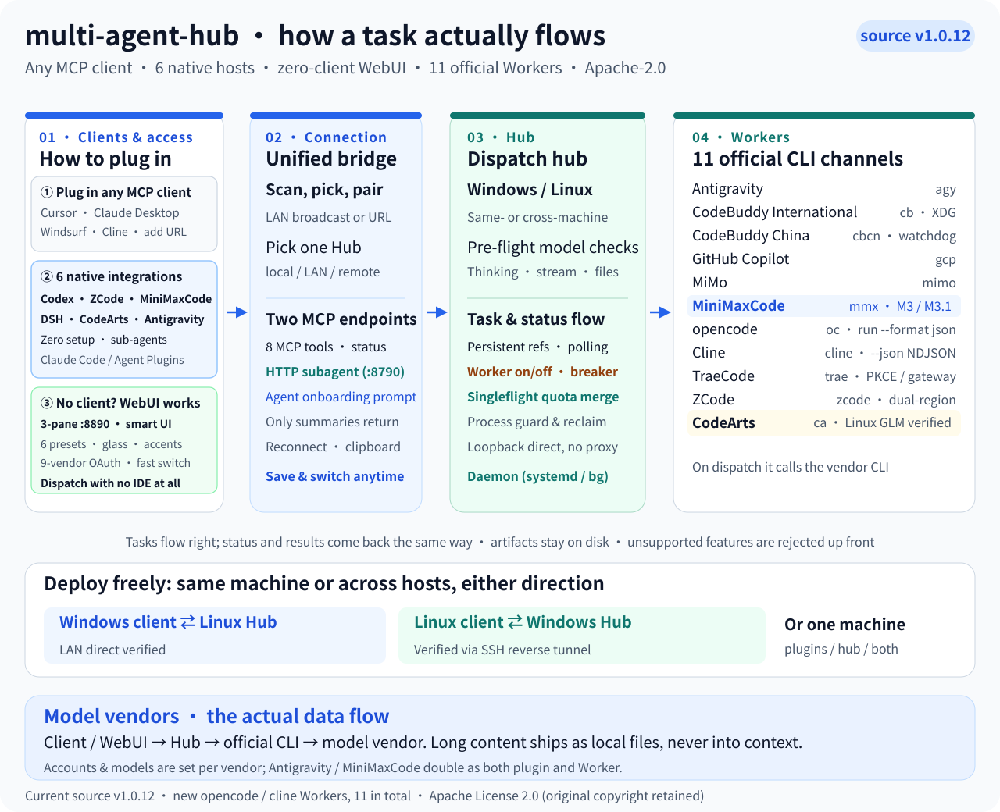
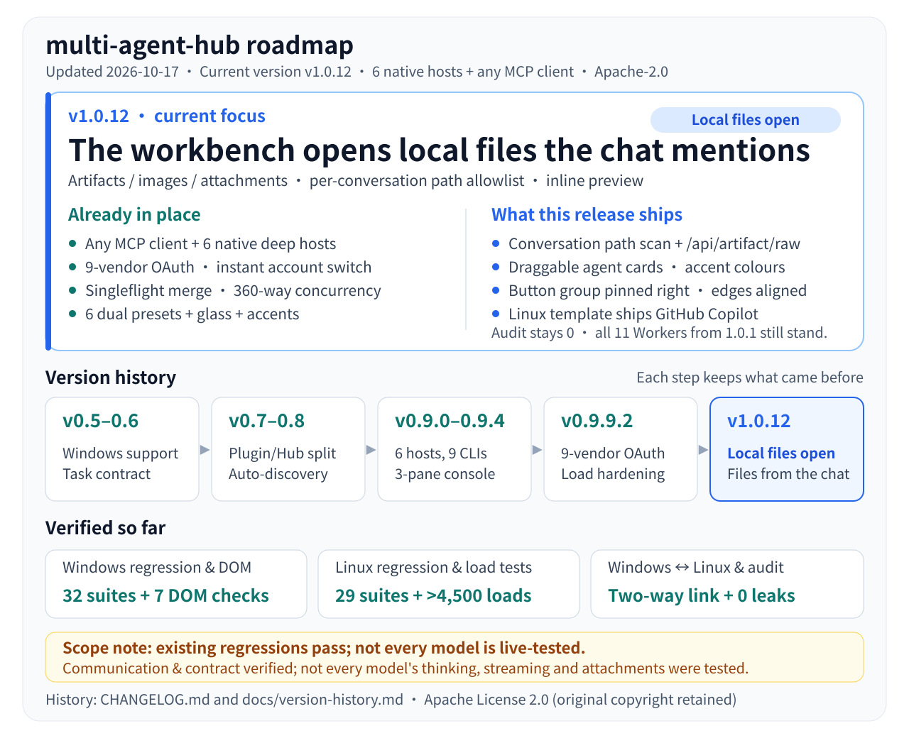

# multi-agent-hub

**English** · [简体中文](README.md)

**multi-agent-hub** is a local dispatch hub that turns 11 scattered AI coding CLIs (**Workers** — the tools that execute delegated tasks) into one shared worker pool. If you juggle CodeBuddy, Copilot, Antigravity, TraeCode, and other CLIs, you no longer have to switch tools and re-explain your prompt when one account hits its quota limit — your current AI client can hand the task straight to another AI.



**Current version: v1.0.15** · License: [Apache-2.0](LICENSE) · Changelog: [CHANGELOG.md](CHANGELOG.md)

| Connection Mode | Best For | What You Do |
| --- | --- | --- |
| **Any MCP Client** | Cursor, Claude Desktop, Windsurf, Cline / Roo Code, Continue, and any client supporting MCP (Model Context Protocol, an open standard for connecting AI clients to external tools) | Add one MCP URL (`http://127.0.0.1:8790/mcp`) |
| **6 Native Host Plugins** | Codex, ZCode, MiniMax Code (including Claude Code / Agent Plugins 1.0), DeepSeek Harness (DSH), Huawei CodeArts, and Antigravity (**Hosts** — the primary clients where you start tasks) | Run the installer to register dedicated `hub-*.md` sub-agents (helper agents running in isolated context), skills, and slash commands |
| **Zero-Client WebUI** | Machines without an IDE or AI client installed | Open the built-in three-pane WebUI (`http://localhost:8890`) to chat, dispatch, and monitor |

**Key Capabilities**

- 🤖 **Dispatch to 11 Workers under one contract**: Run tasks across Antigravity, CodeBuddy (International / China), GitHub Copilot, MiMo, MiniMax, TraeCode, ZCode, CodeArts, opencode, and Cline; each task uses the target Worker's own quota while sharing one task queue, mailbox, and note board.
- 🔌 **Auto-configure 6 native hosts**: The installer writes native sub-agents, slash commands, and workflows automatically, keeping sub-agent context isolated from your main chat.
- 🔐 **Log in and switch accounts for all 11 Workers in the WebUI**: Supports 9 OAuth vendors, Cline device-code auth, and opencode API keys; log in, log out, save multiple accounts, and switch in one click without SSH, verifying real on-disk credentials so fake logins never pass.
- ⚡ **Toggle Workers on or off across every client at once**: Disabling a Worker in the console blocks dispatch requests immediately (`profile_disabled`) before any quota is spent.
- 🛡️ **Reject empty or truncated answers**: Filters out blank replies, known crash exits, and partial output after timeouts; preserves the original task `ref` (persistent tracking ID) and blocks any Worker from dispatching tasks to itself.
- 🔄 **Deploy on one machine or split across machines**: Runs on Windows, Linux, or Windows ↔ Linux over LAN or SSH reverse tunnels; keeps config and credentials outside the repo directory so upgrades never wipe task history.
- 🔍 **Scan the LAN and auto-reconnect**: Clients discover available Hubs via UDP broadcast and reconnect automatically after config changes.
- 🖥️ **Preview offline in a single file**: Open `demo.html` in any browser to try the full three-pane console without starting a backend.

---

## Contents

1. [Up and Running in 30 Seconds](#up-and-running-in-30-seconds)
2. [Choose How to Connect](#choose-how-to-connect)
3. [Native Host Plugin Setup](#native-host-plugin-setup)
4. [Supported Workers and Default Models](#supported-workers-and-default-models)
5. [MCP Tools and Task Contract](#mcp-tools-and-task-contract)
6. [Inside the Web Console](#inside-the-web-console)
7. [Verification Status and Boundaries](#verification-status-and-boundaries)
8. [Data Flow and Security](#data-flow-and-security)
9. [Prebuilt Packages, Development, and Testing](#prebuilt-packages-development-and-testing)
10. [Version History, Documentation, and License](#version-history-documentation-and-license)

---

## Up and Running in 30 Seconds

Three commands start the Hub scheduler, launch the Web console, and register native plugins for any supported hosts already on your machine.

### Requirements

- **Python 3.8+** (**3.11+** required to install the Codex native plugin)
- **Node.js 20+** (runs the local MCP bridge and Web console)
- **Official vendor CLIs logged in** for the Workers you plan to use (such as `agy`, `cb`, `trae`, `codearts`). The installer probes your environment and invokes CLIs, but does not register vendor accounts for you.

### Start Commands

**Linux / macOS**

```bash
git clone https://github.com/Johhny-Xu/multi-agent-hub.git
cd multi-agent-hub
sh install.sh --with-console
```

**Windows (PowerShell / CMD)**

```powershell
git clone https://github.com/Johhny-Xu/multi-agent-hub.git
cd multi-agent-hub
.\install.cmd --with-console
```

**What You See When It Succeeds**

- Open `http://localhost:8890` in your browser to access the three-pane Web console (activity bar and session tree on the left, chat in the center, workbench and 11 Worker status cards on the right).
- You can also download `agenthub-1.0.15-both.zip` from [Releases](https://github.com/Johhny-Xu/multi-agent-hub/releases), extract it, and run the same install command. When run from a git checkout, the installer builds a release bundle in a temporary directory automatically.
- Daily start and stop: `sh start.sh` / `sh stop.sh` (Windows: `start.bat` / `stop.bat`).
- Want to preview the UI first? Open `demo.html` directly in your browser.

> 💡 On Linux, run `sh install.sh` rather than `./install.sh` so installation still works if an archive utility strips executable permissions (`Permission denied`). See [RUN_ON_LINUX.md](RUN_ON_LINUX.md).

### Default Ports

| Port | Service | Purpose and Clients |
| --- | --- | --- |
| `8765` | **Hub Core Service** (`http://<host>:8765/mcp`) | Requires a bearer **Token** (authentication key); used by the 6 native host plugins and cross-machine clients |
| `8890` | **Web Console** (enabled with `--with-console`) | Open `http://localhost:8890` in a browser to manage accounts, quotas, Worker switches, and direct chats |
| `8790` | **Built-in Sub-agent MCP Endpoint** (`http://127.0.0.1:8790/mcp`) | Starts alongside the console; lets Cursor, Windsurf, and other generic MCP clients connect without a plugin |

---

## Choose How to Connect

You can paste a single prompt into your current AI assistant to let it install everything, or set up a single-machine, plugin-free, or cross-machine deployment yourself.

### Option 0: Let Your AI Install It (Recommended)

Copy the matching prompt below and send it to your AI assistant; it will clone the repo, run the installer, and verify the connection.

<details>
<summary><b>Generic prompt for any native host</b> (Antigravity / CodeArts / ZCode / Codex / DSH / MiniMax Code)</summary>

```text
Clone https://github.com/Johhny-Xu/multi-agent-hub.git, read its README.md, and based on the client I am using run install.cmd (Windows) or sh install.sh (Linux/macOS) to install the Multi-Agent Hub service and this client's native plugin (sub-agents, skills, and MCP bridge). Then call hub_status to verify the connection.
```

</details>

<details>
<summary><b>Host-specific prompts</b> (replace <code>&lt;current project path&gt;</code> with your workspace directory)</summary>

- **Google Antigravity**
  ```text
  Clone https://github.com/Johhny-Xu/multi-agent-hub.git, run install.cmd (sh install.sh on Linux) with --native-hosts antigravity to install the Multi-Agent Hub native plugin and its 11 hub-* sub-agents into ~/.gemini/config/plugins/multi-agent-hub, and start the Hub service.
  ```
- **Huawei CodeArts (IDE / CLI)**
  ```text
  Clone https://github.com/Johhny-Xu/multi-agent-hub.git and run install.cmd --native-hosts codearts --project <current project path> (sh install.sh on Linux) to install the Multi-Agent Hub service and register this workspace's .codeartsdoer/mcp/mcp_settings.json and dedicated sub-agents.
  ```
- **MiniMax Code (`mcode`) / Claude Code**
  ```text
  Clone https://github.com/Johhny-Xu/multi-agent-hub.git, start its Multi-Agent Hub service, and load the repository's plugins/agenthub-workers directory as a native plugin (including .minimax-plugin/plugin.json, .claude-plugin/plugin.json, hub-bridge.mcp.json, and the dispatch-hub skill) into this client.
  ```
- **ZCode (IDE / CLI)**
  ```text
  Clone https://github.com/Johhny-Xu/multi-agent-hub.git, run install.cmd --native-hosts zcode (sh install.sh on Linux) to register the plugins/agenthub-workers native plugin (11 external Worker sub-agents plus the MCP bridge) with my ZCode environment, and start the Hub.
  ```
- **OpenAI Codex**
  ```text
  Clone https://github.com/Johhny-Xu/multi-agent-hub.git and run install.cmd --native-hosts codex --project <current project path> (sh install.sh on Linux) to configure the Codex native plugin marketplace and the .codex/agents/ routing rules for this workspace.
  ```
- **DeepSeek Harness (DSH)**
  ```text
  Clone https://github.com/Johhny-Xu/multi-agent-hub.git and run install.cmd --native-hosts dsh (sh install.sh on Linux), or mount the native presets and workflow plugin with dsh plugin add file:./integrations/dsh.
  ```

</details>

<details>
<summary><b>Generic MCP clients</b> (Cursor / Windsurf / Claude Desktop / Cline / Roo Code / Continue)</summary>

When a Hub and console are already running:

```text
Add a Streamable HTTP MCP server named "multi-agent-hub" with URL http://127.0.0.1:8790/mcp to this client's MCP config (replace with the server's IP if it runs on the LAN), then call the subagent_agents tool to list the available external sub-agents.
```

From scratch:

```text
Clone https://github.com/Johhny-Xu/multi-agent-hub.git, run install.cmd --with-console (sh install.sh --with-console on Linux) to start the Multi-Agent Hub and Web console (:8890 / :8790), then write http://127.0.0.1:8790/mcp into this client's MCP config.
```

</details>

### Option 1: All-in-One Local Setup

Best when you code on a single machine and want the Hub, Web console, and plugins for every installed IDE configured in one step. Run the commands in [Up and Running in 30 Seconds](#up-and-running-in-30-seconds); the installer automatically detects and registers Codex, ZCode, DSH, CodeArts, and Antigravity plugins and sub-agents.

### Option 2: Direct MCP Connection Without Plugins

Best for Cursor, Claude Desktop, Windsurf, Cline / Roo Code, and Continue. Start the console with `--with-console`, then connect in either of two ways:

1. In the console at `http://localhost:8890`, click **Copy this text (send it to your agent)** on the "Sub-agent endpoint" card and paste the prompt to your AI assistant;
2. Or add the endpoint to your client's MCP config file manually:

```json
{
  "mcpServers": {
    "multi-agent-hub": { "url": "http://127.0.0.1:8790/mcp" }
  }
}
```

This exposes 4 tools: `subagent_run` (waits server-side for completion, saves large outputs to disk, and returns a concise summary so your main chat context stays clean), `subagent_result`, `subagent_artifact`, and `subagent_agents`.

### Option 3: Cross-Machine Setup (Server + Workstation)

Best when you run the Hub and vendor CLIs on a home server, NAS, or cloud VM and write code on a laptop. Replace `<SERVER_IP>` with your server's IP address and `<TOKEN_FILE_PATH>` with the local path to your copied `hub-token.txt`.

```bash
# 1. Server (Linux): listen on the LAN and start the console; generates a random hub-token.txt in the external config dir
sh install.sh --component hub --bind 0.0.0.0 --port 8765 --with-console
```

```powershell
# 2. Client (Windows): pair with the server using its URL and the copied token file
.\install.cmd --component plugins --url http://<SERVER_IP>:8765/mcp --token-file <TOKEN_FILE_PATH>
```

- **LAN auto-discovery**: Omit `--url` on the client to scan the LAN via UDP broadcast and pick a Hub interactively.
- **Switch Hubs anytime**: Run `connect.cmd` (Linux: `sh connect.sh`).
- **Connect across networks**: Forward the port over an SSH reverse tunnel, e.g. `ssh -N -R 127.0.0.1:18765:127.0.0.1:8765 <USER>@<SERVER_IP>`.
- **Run as a Linux background service**: Add `--systemd-user` on the server to register a user-level systemd unit (runs the Hub core service only, without the Web console).

---

## Native Host Plugin Setup

To install a plugin for just one host, import the prebuilt package or run the targeted command below (replace `<workspace path>` with your project directory; on Linux, replace `.\install.cmd` with `sh install.sh`).

| Native Host | Installation Method | Documentation |
| --- | --- | --- |
| **Huawei CodeArts / VS Code** | In the Extensions panel choose "Install from VSIX/CARTS" and import `multi-agent-hub-1.0.15.carts` / `.vsix` / `.cloudide`; or run `.\install.cmd --component plugins --native-hosts codearts --project <workspace path>` | [codearts](integrations/codearts/README.md) · [vscode](integrations/vscode/README.md) |
| **MiniMax Code / Claude Code** | Import `agenthub-workers-1.0.15-minimax-plugin.zip` in the desktop or cloud app; or start the CLI with `mcode --plugin-dir ./plugins/agenthub-workers` | [agenthub-workers](plugins/agenthub-workers/README.md) |
| **ZCode IDE / CLI** | Run `.\install.cmd --component plugins --native-hosts zcode`; or set `{"plugins":{"enabled":true,"dirs":[".../plugins/agenthub-workers"]}}` in `zcode.json` | [agenthub-workers](plugins/agenthub-workers/README.md) |
| **OpenAI Codex** | Run `.\install.cmd --component plugins --native-hosts codex --project <workspace path>` to register a local plugin marketplace and write 11 sub-agents to `.codex/agents/` | [codex](integrations/codex/README.md) |
| **DeepSeek Harness (DSH)** | Run `.\install.cmd --component plugins --native-hosts dsh --profile agenthub-client`; or run `dsh plugin --profile <PROFILE> add file:./integrations/dsh --ignore-scripts` | [dsh](integrations/dsh/README.md) |
| **Google Antigravity** | Run `.\install.cmd --component plugins --native-hosts antigravity` to install into `~/.gemini/config/plugins/multi-agent-hub`, then restart the client | [antigravity](integrations/antigravity/README.md) |

<details>
<summary><b>Antigravity native plugin and optional Python SDK notes</b></summary>

- The native plugin installs `plugin.json`, 11 sub-agents (`agents/*.md`), 4 skills (`skills/*/SKILL.md`), and an `mcp_config.json` exposing 8 bridge tools.
- The optional Python SDK is pinned to `google-antigravity==0.1.21` and provides typed `SubagentConfig` and serial / parallel orchestration. Note that the published wheel does not include `beta.run_workflow`, and SDK API authentication is separate from IDE / CLI logins.

</details>

<details>
<summary><b>CodeArts two-way integration and workspace switching</b></summary>

The CodeArts native package includes 11 sub-agents, 3 slash commands, 1 dispatch skill, 1 Hooks plugin, and 8 MCP tools. CodeArts can both dispatch tasks as a host and accept tasks as a Worker (`worker="codearts"`, aliases `ca`, `huawei-codearts`).

- **Single call path**: Follows `tool_search → tool_describe → tool_call`; blocks raw XML tags in prose to prevent double dispatch; dispatches each task once and polls thereafter.
- **Permission handling and terminal state**: Returns `blocked_permission` with the original `ref` immediately if the host denies permission rather than retrying under another tool name; marks a task `completed` only when the Worker returns a non-empty answer.
- **Windows CLI isolation**: Targets the official `installers/bin/codearts.exe` binary with its own `cli-data` directory and session database, separate from the IDE; reports untrusted folders as `CODEARTS_PERMISSION_REQUIRED`.
- **Linux process group cleanup**: Runs the driver and Hub in one process group so cancellations and timeouts terminate every child process cleanly.

Install only the CodeArts plugin and connect to a remote Hub (replace `<workspace path>`, `<SERVER_IP>`, and `<TOKEN_FILE_PATH>`):

```powershell
.\install.cmd --component plugins --native-hosts codearts --project <workspace path> --url http://<SERVER_IP>:8765/mcp --token-file <TOKEN_FILE_PATH>
```

```bash
sh install.sh --component plugins --native-hosts codearts --codearts-target cli --url http://<SERVER_IP>:8765/mcp --token-file <TOKEN_FILE_PATH>
```

`--project` must point to the workspace directory open in the IDE (or pass `--codearts-ide-settings` to point directly to the MCP settings file). Reload the IDE window or restart the CLI after installation.

**Reconnect after switching workspaces** (reuses your external `client.json` without re-entering the token; replace `<new workspace path>`):

```powershell
python integrations/codearts/install.py --config "$env:LOCALAPPDATA/AgentHub/client.json" --ide-settings "<new workspace path>/.codeartsdoer/mcp/mcp_settings.json" --target ide --apply
```

Then run "Developer: Reload Window" in the IDE and test with `/hub-status`. See the [CodeArts package docs](integrations/codearts/README.md).

</details>

---

## Supported Workers and Default Models

The Hub schedules all 11 Workers below. The table shows default models for **fresh installations**; upgrading an existing server keeps your configured models intact.

| Worker | Default Model | Specs and Auth Notes |
| --- | --- | --- |
| **Antigravity** | `gemini-3.8-flash-medium` | 6 curated models including 3.8 Flash (High/Medium), 3.1 Pro High, and Claude 4.6 (Sonnet/Opus); supports multimodal input |
| **CodeBuddy** (China) | `deepseek-v4.1-flash` (x0.11) | 13 coding models labeled with official credit multipliers (x0.06–x2.00); shares XDG session storage |
| **CodeBuddy** (International) | `deepseek-v4.1-flash` | 18 mainstream models; file read/write tools require actual filesystem permissions |
| **GitHub Copilot** | `auto` | Uses official model selection; supports WebUI device-code login and Linux GNOME Keyring credentials |
| **MiMo** | `xiaomi/mimo-v2.6-flash` (26f) | 4 V2.6 models; keeps API key auth separate from Xiaomi OAuth identity |
| **MiniMax** | `MiniMax-M3` | One-click switch between M3 (1M context) and M3.1-Flash-Preview (512K context) |
| **TraeCode** | `GLM-5.3-FlashX` (0.31x) | 20 official models with 0.06x–1.50x credit multipliers; dual-region PKCE OAuth and TraeClaw gateway |
| **ZCode** | `GLM-5.3-Flash` | China (BigModel) and International (Z.ai) regions; encrypts stored credentials with `enc:v1:` AES-256-GCM |
| **CodeArts** | `GLM-5.2` (0.70x) | 4 enterprise models (GLM-5.2, GLM-5.2-ArkTS-SPARK, OpenPangu-2.0-Pro/Flash); Linux CLI auto-loads AK/SK |
| **opencode** | Official CLI default | Configure API keys in the WebUI, parse NDJSON event streams, and display a dedicated brand accent color |
| **Cline** | Official CLI default | Authorize via device code in the WebUI, parse NDJSON event streams, and display a dedicated brand accent color |

---

## MCP Tools and Task Contract

Every native host plugin exposes the same **8 MCP tools** through the local bridge and enforces a single contract for attachments and working directories.

| Tool | Purpose |
| --- | --- |
| `hub_ask` | Dispatch a task and wait for the final answer |
| `hub_dispatch` | Dispatch asynchronously and return a persistent `ref` immediately |
| `hub_fetch` | Poll task status or retrieve the final result by `ref` |
| `hub_status` | List online and enabled states for all 11 Workers |
| `hub_capabilities` | Query supported models, thinking levels, streaming, and attachment limits |
| `hub_login` | Check login status or start a login flow for a Worker |
| `hub_discover` | Scan the local machine and LAN for available Hubs (read-only) |
| `hub_set_status` | Enable or disable a Worker and sync the state across all clients |

**Three Task Contract Rules**

1. **Attachment limit**: `files` accepts up to 8 files totaling at most 1 MiB, staged on the Hub host.
2. **Working directory**: `cwd` always refers to a path **on the Hub's host machine**; client paths are never mapped automatically.
3. **Result tracking and verification**: Accepted tasks return a persistent `ref` — poll with `hub_fetch` instead of re-dispatching. A `completed` state means the Worker exited cleanly with a non-empty answer; the caller is still responsible for verifying the output. See [Task Options](docs/task-options.md) for all parameters.

---

## Inside the Web Console

Pass `--with-console` at startup and open `http://localhost:8890` to chat, dispatch tasks, switch accounts, check quotas, and inspect local files from one screen.

| Module | What You Can Do |
| --- | --- |
| **Three-Pane Workbench & File Preview** | Browse the platform session tree on the left, chat in the center, and open local files mentioned in the conversation inside the collapsible right-hand workbench (supports artifact, image, and attachment previews plus single-item deletion) |
| **11-Worker Login & Account Switching** | Complete logins for 9 OAuth vendors, Cline device codes, and opencode API keys directly in the browser; log out, save multiple accounts, and switch in one click without SSH |
| **Live Quotas & Worker Switches** | Monitor remaining quota per account (60 s cache with request coalescing); toggle Workers on or off on each card (saved to `agents.json` and synced everywhere) and drag cards to reorder |
| **Smart Reveal / Collapse** | Top bar, activity bar, and session sidebar expand when your cursor approaches and hide when it leaves; click the top-left brand icon to pin or unpin the layout |
| **12 Themes & Glass Wallpaper** | Switch between Mocha, Shell, Aurora, Dusk, Cyber, and Grid in light or dark mode (all WCAG AA contrast-calibrated); upload a custom wallpaper to switch the UI to translucent glass |
| **Sub-agent Accent Colors** | The send button, context progress bar, and secondary menus adopt the active Worker's brand color (including opencode and Cline accents) |
| **Cross-Platform Session Archive** | Search and filter archived chats across platforms, restore sessions in one click, and confirm twice before permanent deletion |
| **Sub-agent MCP Endpoint Card** | Copy the `:8790/mcp` URL or a ready-to-send setup prompt in one click; includes an automatic clipboard fallback when accessed over plain-HTTP LAN IPs |

<details>
<summary><b>Frontend layout and interaction details</b></summary>

- Brand anchor `#brand-logo-pin` (`z-index: 120`) stays visible at all times. Trigger zones: top bar `Y ≤ 38px`, activity bar `X ≤ 42px`, with a 90 ms reveal delay and 650 ms collapse debounce; bars remain pinned while a modal is open, an input is focused, or the sidebar is expanded; top-bar and floating button right edges align.
- The sidebar trigger zone spans its full footprint (`X ≤ 324px` on a `1440px` viewport); session cards render on a single line and load `/api/chat/agent-summary` summaries on demand.
- Top bar (`z-index: 100`) and chat header (`z-index: 50`) maintain independent stacking contexts so dropdowns are never clipped by code blocks or the workbench.
- Glass mode (`body.has-custom-bg`) applies `backdrop-filter: blur(20px~24px) saturate(180%~190%)`, unifies neutral surfaces to `--gem-bg-card`, and reserves `--gem-surface-high` for hover states and the progress track.
- `--agent-accent` styles the send button, context progress bar, and `#panel-chat` secondary menus while keeping model names in body color `--gem-text`.
- Clicking anywhere on the bottom status bar opens the metric picker (model, latency, TPS, tokens, quota); the model drawer provides thinking-level and streaming toggles; the footer displays `v1.0.15` (overridable by backend `snap.version`).
- Offline demo build: `scripts/build_demo.py` and `scripts/demo_engine.js` generate `demo.html` and `demo/index.html`.

</details>

---

## Verification Status and Boundaries

> **Important: Passing regression tests does not mean paid end-to-end runs on every commercial model.** The automated checks below verify the scheduling engine, MCP bridge, and process lifecycle; they do not guarantee that every vendor, model, or host has run a paid task under your account.

| Verification Item | Result | Verifiable Evidence and Report Path |
| --- | --- | --- |
| Windows Regressions & DOM Assertions | ✅ 32 suites + 7 DOM checks passed | See `docs/refactor-validation.json` and `tests/console_layout_theme_dom.mjs` |
| Linux Regressions & Load Tests | ✅ 29 suites + 4,500+ requests passed | 360 concurrent requests with 0 errors; see `docs/stage3-stress-report.json` |
| Linux Production Hub Upgrade | ✅ Passed | Loaded 24 Hub tools and 11 Workers while preserving external config, task history, and auth |
| Linux Antigravity CLI 1.3.1 | ✅ Real call passed | Dispatched through native sub-agent `hub-mimocode` and returned a live answer |
| Linux ZCode CLI 0.16.9 | ✅ Real call passed | Polled the original `ref` and returned the expected answer |
| Windows Codex / ZCode Native Plugins | ✅ Real call passed | Both native sub-agents dispatched tasks and returned answers |
| Windows Antigravity Native Plugin | ✅ Real call passed | `hub_status` and `hub_capabilities` returned all 11 Workers |
| CodeArts Native Components & Channels | ✅ Passed | Verified Windows ↔ Linux LAN and SSH reverse tunnel connections |
| Linux CodeArts Built-in Models | ✅ Real call passed | Completed GLM-5.2 calls in seconds and exited all child processes cleanly |
| Windows DSH Host | ⚠️ Blocked by account balance | Plugin registration passed; model invocation returned `402 ACCOUNT_QUOTA` |
| Windows CodeArts IDE Host | ⚠️ Partial pass | Initial dispatch succeeded, but the IDE host blocked the follow-up `hub_fetch` call |
| Windows Standalone CodeArts CLI | ⚠️ Not yet accepted | Blocked by the Windows folder-trust prompt |
| Linux Codex & DSH CLI | ❌ Not installed | Binaries were not installed on the Linux test host; no pass claimed |

**Operational Boundaries**

1. **Antigravity native plugin vs. optional SDK**: The native plugin has completed live calls; the optional Python SDK is an external orchestration library whose current wheel lacks `beta.run_workflow` and uses separate API credentials from the host login.
2. **CodeArts credential isolation**: Logging into the CodeArts IDE does not authorize the standalone CLI, and credentials from other vendors cannot substitute for Huawei account permissions; only default thinking and non-streaming text are enabled.
3. **Single-Hub targeting**: A client connects to one selected Hub at a time rather than a multi-Hub federation.

For full receipts, source hashes, and failure logs, see the [0.9.9 Acceptance Record](docs/release-0.9.9.md) and the [CodeArts IDE Follow-up](docs/codearts-ide-followup.md).

---

## Data Flow and Security

The Hub routes tasks and manages CLI processes locally or on your private server while keeping credentials outside the repository.

- **Data path**: `Host Client → Local MCP Bridge → Hub Service → Official Vendor CLI / Kernel → Model Vendor API`.
- **Not an offline LLM**: The Hub does not run inference itself; prompts and attachments are sent to the selected model vendor through its official CLI.
- **Credential isolation**: Hub bearer tokens, API keys, OAuth tokens, and session histories are stored in external OS config directories outside the repository and are never committed to Git.
- **Network transport**: The bearer token authenticates requests but does not encrypt traffic; when exposing a Hub across the internet, put it behind an HTTPS reverse proxy, VPN, or SSH tunnel.
- To report a security vulnerability, follow the process in [SECURITY.md](SECURITY.md).

---

## Prebuilt Packages, Development, and Testing

### Prebuilt Release Packages

Every release includes `SHA256SUMS` checksums and can be downloaded from Releases or built from source:

| File | Target Use Case |
| --- | --- |
| `agenthub-1.0.15-both.zip` | Run both the Hub and client plugins on the same machine (recommended) |
| `agenthub-1.0.15-plugins.zip` | Install host plugins on a coding workstation only |
| `agenthub-1.0.15-hub.zip` | Run the Hub and Workers on a dedicated server only |
| `agenthub-workers-1.0.15-minimax-plugin.zip` | Import into MiniMax Code desktop or cloud (Plugin V1 format) |
| `multi-agent-hub-1.0.15.vsix` / `.carts` / `.cloudide` | Install into Huawei CodeArts IDE, VS Code, or compatible cloud / desktop editors |

### Development and Test Commands

Run these commands from the repository root (replace `<output dir outside repo>` with a path such as `../agenthub-releases`):

```bash
# 1. Run the full isolated regression suite (sandboxed, zero model charges)
python tests/run_regressions.py --report docs/local-validation.json

# 2. Run Web console DOM, theme contrast, and reveal/collapse assertions
node --test tests/console_layout_theme_dom.mjs

# 3. Audit the working tree and full Git history for leaked secrets
python scripts/audit_secrets.py --history

# 4. Rebuild the single-file offline demo after editing console/client/index.html
python scripts/build_demo.py

# 5. Build all release packages (output directory must be outside the repo)
python packaging/build.py --output <output dir outside repo> --component all
```

To enable the real-SDK and real-CLI integration tests that are skipped by default, install:

```bash
pip install google-antigravity==0.1.21
npm i -g @openai/codex && export CODEX_TEST_BINARY=$(command -v codex)
```

Before submitting patches, see [CONTRIBUTING.md](CONTRIBUTING.md) and [CODE_OF_CONDUCT.md](CODE_OF_CONDUCT.md). Full packaging flags are documented in [packaging/README.md](packaging/README.md).

---

## Version History, Documentation, and License

### Recent Releases

| Version | Highlights |
| --- | --- |
| **1.0.15** | Check-in now reuses the credentials of installed CLIs: every run reads the CLI's own credential files, picks the freshest by JWT expiry and file mtime, and deduplicates by identity; WorkBuddy auto-renews its access token through refreshToken and writes it back to the CLI's `auth.info` (one shared copy, nothing gets logged out); check-in logs can be cleared in one click; the international `~/.codebuddy` token is no longer used |
| **1.0.14** | Ran all 84 models one by one: keep the real stderr diagnostic when a CLI exits 0 with an empty answer, add `plan_blocked` to separate "plan not entitled" from "model does not exist", and grey out models outside the alias table; corrected three model-catalog entries; fixed four mobile layout defects (settings card title stacked vertically, numbers split across lines, send button wrapping at 320px, check-in toggle squeezed into a narrow column) |
| **1.0.13** | Check-in went from "looks successful" to "actually successful": per-account WorkBuddy claims, real SDK-HMAC-SHA256 signed CodeArts calls, and Trae now queries status before claiming; account profiles no longer lose a second API key, split one identity into two, or freeze display names; added a per-sub-agent file-editing permission switch; deduplicated the Huawei model list by id |
| **1.0.12** | Workbench opens local files mentioned in chat (artifact, image, and attachment previews plus single-item deletion); draggable sub-agent cards with opencode and Cline brand colors; aligned top-bar and floating button right edges; added a working GitHub Copilot Worker entry to the Linux template |
| **1.0.1** | Added opencode and Cline Workers (11 total) with config templates, capability declarations, NDJSON stream parsing, and native sub-agents; redrew architecture and roadmap SVGs with larger text and higher contrast |
| **1.0.0** | First public release: full secret audit cleanup, TraeClaw attribution, sanitized handover docs, Code of Conduct, and release review fixes |
| **0.9.9.7 – 0.9.9.9** | Fixed Linux source install exec-bit loss and loopback proxy hijacking; added Node 20 WebSocket compatibility, English README, security policy, contributing guide, and updated diagrams |
| **0.9.9.3 – 0.9.9.6** | Rebuilt on-disk login verification across Workers; shipped the three-pane WebUI, 6 light/dark themes, glass wallpaper mode, and smart reveal/collapse |



See [CHANGELOG.md](CHANGELOG.md) and [Version History](docs/version-history.md) for the complete log.

### Documentation Index

- **Setup & Options**: [Running on Linux](RUN_ON_LINUX.md) · [Packaging & Installer Options](packaging/README.md) · [Task Options](docs/task-options.md)
- **Host Integration Guides**: [Codex](integrations/codex/README.md) · [ZCode / MiniMax Code](plugins/agenthub-workers/README.md) · [DSH](integrations/dsh/README.md) · [Antigravity](integrations/antigravity/README.md) · [CodeArts Native Plugin](integrations/codearts/README.md) · [CodeArts IDE & VS Code Extension](integrations/vscode/README.md)
- **CodeArts Deep Dives**: [Two-Way Integration & Auth Boundaries](docs/codearts-compatibility.md) · [CodeArts IDE Follow-up](docs/codearts-ide-followup.md) · [Using Existing Model Routes](docs/codearts-custom-provider.md)
- **Acceptance & Handover**: [0.9.9 Acceptance Record](docs/release-0.9.9.md) · [Network Discovery Acceptance (v0.8)](docs/release-0.8.md) · [Development Handover](docs/HANDOVER_20261016.md)

### Acknowledgements

- [LobeHub / Lobe Icons](https://github.com/lobehub/lobe-icons) for the brand SVG icons used in the console and sub-agent avatars.
- [TraeClaw](https://github.com/firerlAGI/TraeClaw) for the local bridge and CDP/DOM automation powering the `trae_delegate` channel.
- Huawei CodeArts, Google Antigravity, Tencent CodeBuddy, GitHub Copilot, Xiaomi MiMo, MiniMax, ByteDance Trae, Z.ai, opencode, Cline, their official CLIs, and everyone who contributed feedback.

### License

Licensed under the [Apache License 2.0](LICENSE): you may use, modify, and distribute this software freely, provided that derivative works retain the copyright notice, license text, and a statement of changes.
