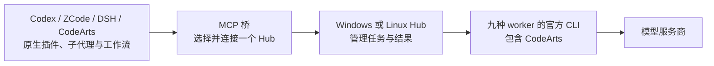

# multi-agent-hub

在 Codex、ZCode、DeepSeek Harness（DSH）、华为 CodeArts 中，通过原生插件和子代理调用其他客户端的 worker。multi-agent-hub 已适配四种宿主、九种 worker，负责运行官方 CLI、管理任务与返回结果；具体能否执行取决于目标机器的 CLI、账号和模型状态。

当前源码版本 **0.9.0** 新增 CodeArts 双向接入：它可以作为客户端派发给其他 worker，也可以作为 worker 接受 Codex、ZCode、DSH 等客户端的任务。源码标签仍截至 **v0.8.0**；0.9.0 安装包已在本机构建并校验，尚未上传 GitHub Release。

**插件和 Hub 可以装在不同机器，也可以一起安装。** Windows 的 CodeArts 或 Codex 可以连接 Linux 服务器上的 Hub，Linux 客户端也可以连接 Windows 上的 Hub。客户端不需要启动本地 Hub，服务器也不需要安装四种宿主插件。

## CodeArts 接入与当前实测

CodeArts 原生包包含 **9 个子代理、3 个命令、1 个调度技能、1 个 Hooks 插件和 7 个 MCP 工具**。在 CodeArts 中可用 `@hub-mimocode` 等子代理，或 `/hub-status`、`/hub-discover`、`/hub-login`；其他宿主派发给 CodeArts 时使用 `worker="codearts"`，也接受 `ca`、`huawei-codearts`。

| 验证项目 | 实际结果 |
| --- | --- |
| Windows CodeArts 原生组件 | 正式内核识别代理、命令、技能与插件入口；当前 IDE 窗口需重载 |
| Linux CodeArts | 官方 CLI 原生文件及 MCP 已安装；本轮未找到图形 IDE 本体 |
| CodeArts MCP 桥 → 其他 worker | Linux 上单次派发 MiMo，实际回答 `42` |
| Windows → Linux | 局域网通信通过；CodeArts 任务准确返回认证失败 |
| Linux → Windows | SSH 反向回环转发通过；CodeArts 任务准确返回 provider 未就绪 |
| CodeArts 自身模型调用 | **尚未通过**：Windows 独立内核缺 provider；Linux 非交互 CLI 缺所需 AK/SK 认证 |

IDE 已登录不代表独立 CLI 已具备模型调用条件。当前 CodeArts worker 仅开放默认思考、非流式文本任务，图片、文件及显式思考开关关闭。组件安装和 MCP 派发验收通过，也不能证明 CodeArts 编排模型已经自主调用这些工具。完整报告与认证边界见 [CodeArts 接入说明](docs/codearts-compatibility.md)。

只安装 CodeArts 客户端、连接已有 Hub 的例子：

~~~powershell
.\install.cmd --component plugins --native-hosts codearts --project C:\Work\my-project --url SERVER:8765 --token-file C:\private\hub-token.txt
~~~

~~~bash
./install.sh --component plugins --native-hosts codearts --codearts-target cli --url SERVER:8765 --token-file /private/hub-token.txt
~~~

IDE 的 `--project` 应指向实际打开的工作区；也可用 `--codearts-ide-settings` 指定“配置 MCP”打开的文件。未提供工作区时，自动安装将 IDE 连接标为待配置。安装后重载 IDE 或重启 CLI。独立安装说明见 [CodeArts 原生包](integrations/codearts/README.md)。

## 选择安装包

0.9.0 提供三种独立 ZIP，包含 CodeArts 双向接入及本机与局域网 Hub 自动发现；源码构建方法见下方。源码已按 v0.5.0 → v0.6.0 → v0.7.0 → v0.8.0 分别提交与打标签；ZIP 安装包仍为本机构建，尚未上传 GitHub Release 附件。

| 包 | 装在哪里 | 包含什么 |
| --- | --- | --- |
| agenthub-0.9.0-plugins.zip | 使用 Codex / ZCode / DSH / CodeArts 的机器 | 四种原生插件、MCP 桥、子代理与工作流 |
| agenthub-0.9.0-hub.zip | 运行 worker 的 Windows / Linux 机器 | Python Hub、worker 适配器、可选网页控制台 |
| agenthub-0.9.0-both.zip | 插件和 worker 都在本机 | 上述两部分 |

解压后，Windows 双击 **install.cmd**，Linux 执行 **bash install.sh**。安装器识别系统、已有 Python/Node 和官方 CLI，使用稳定安装目录，配置与运行数据放在源码包之外。重复安装会备份旧应用文件，保留连接和 worker 配置。完整参数、原生宿主注册及启动方式见[安装说明](packaging/README.md)。

依赖：安装器和 Hub 使用 Python；Codex 项目代理安装需要 Python 3.11+，建议统一使用 **Python 3.11+**。插件桥和可选控制台需要 **Node.js 20+**；桌面 WebSocket 驱动需要 Node.js 22+。各官方 CLI 与登录是独立依赖。自动检测不等于替你创建账号或安装所有厂商客户端；缺少运行时时，安装器给出明确诊断。

## 本机使用

使用 both 包安装，安装器默认立即启动 Hub。后续用安装目录中的 start.cmd / start.sh、stop.cmd / stop.sh、status.cmd / status.sh 管理服务；安装时加 --no-start 可仅安装。需要控制台时加 --with-console；默认只启动 Hub。

~~~powershell
.\install.cmd --component both --with-console
~~~

~~~bash
bash install.sh --component both --with-console
~~~

安装器只为检测到的官方 CLI 建立 worker 配置。未安装、未登录或没有对应模型的 worker 不会因为插件存在就自动可用。可在宿主中查询 hub_capabilities，用 hub_login 获取支持的官方授权链接并查询登录状态。

## Windows 与 Linux 分开安装

首次安装 plugins 包且没有连接配置时，会先扫描本机与局域网 Hub。终端列出可达候选，由你选择本机或服务器；没有发现时提示手动填写地址。配对时使用对应 Hub 的 token 文件或终端隐藏输入，验证成功后才保存。已有连接不会因扫描被覆盖；非交互安装返回待配置提示，不会停在那里等待输入。

以后双击安装目录的 **connect.cmd**（Linux：`./connect.sh`）即可重新扫描并切换。ZCode、CodeArts 内可用 **/hub-discover**，四种宿主都可调用 **hub_discover**，只读列出候选及下一步说明；宿主不会因为工具注册就自动执行它。切换连接前先收回原 Hub 的未完成任务，保存后重启宿主 MCP 进程。

局域网自动发现需要服务器 Hub 为 0.8.0 或更新版本，并监听局域网地址。扫描使用 UDP 18766 与无凭据 HTTP 健康检查，不会广播 token。跨子网、VPN、广播被拦截、旧版本或发现端口被占用时可能找不到，仍可手动连接；不会自动修改防火墙。设置 `AGENTHUB_DISCOVERY=0` 可关闭服务端发现响应。发现到服务器只表示可达，配对还需要鉴权。

以 Linux 运行 Hub、Windows 运行插件为例：

~~~bash
# 在 Linux 解压 hub 包后运行；按需要指定实际监听地址
bash install.sh --component hub --bind 0.0.0.0 --port 8765
~~~

在 Windows 解压 plugins 包，填入服务器的可达地址和外部 token 文件：

~~~powershell
.\install.cmd --component plugins --url http://SERVER_LAN_IP:8765/mcp --token-file C:\private\hub-token.txt
~~~

Hub 非回环监听必须鉴权。安装器生成的 token 保存在外部配置目录的 hub-token.txt，客户端使用这个文件的私有副本；不要把连接文件、token 或厂商登录文件提交进项目。客户端连接文件是 **client.json**：Windows 默认 %LOCALAPPDATA%\AgentHub\client.json，Linux 默认 $XDG_CONFIG_HOME/agenthub/client.json 或 ~/.config/agenthub/client.json。自定义位置可用 AGENTHUB_CONFIG 指定。

反向使用时，把 hub 包装在 Windows，把 plugins 包装在 Linux，客户端 URL 指向 Windows 的可达地址即可。两端都安装 both 也可以；每个插件进程按自己的连接配置选择一个 Hub。这不是自动的 Hub 对 Hub 联邦调度。

直接连接需要网络路由和端口可达，安装器不修改防火墙。无法从服务器直接访问 Windows 时，可通过已有 SSH 连接提供反向转发，例如在 Windows 运行：

~~~powershell
ssh -N -R 127.0.0.1:18765:127.0.0.1:8765 SERVER_SSH_ALIAS
~~~

服务器插件随后连接 http://127.0.0.1:18765/mcp，仍使用 Windows Hub 的 token。这个连接依赖 SSH 进程保持运行。Linux 常驻服务可选择安装器的 --systemd-user，仅支持 Hub，不能与 --with-console 组合；默认不修改系统级服务。

## 使用与能力限制

插件提供七个工具：hub_ask、hub_dispatch、hub_fetch、hub_status、hub_capabilities、hub_login、hub_discover。Codex 的项目子代理与工作流技能、ZCode 的九个原生代理、DSH 的预设与工作流、CodeArts 的原生子代理和技能都通过同一个任务契约派发。

先用 hub_capabilities(worker, model) 查看目标 Hub 的能力和最近失败状态。前端按 **Hub 所在系统、worker、实际配置模型** 约束思考、流式、图片和文件选项；不支持的选项会禁用并解释原因，服务端也会拒绝。自动选择 worker 时使用相同限制。

| worker | 默认模型 |
| --- | --- |
| Antigravity | gemini-3.8-flash-medium |
| CodeBuddy 国际版 / 国内版 | deepseek-v4.1-flash |
| GitHub Copilot | auto |
| MiMo | xiaomi/mimo-v2.6-flash（26f / v2.6f） |
| MiniMax | MiniMax-M3.1-Flash-Preview |
| TraeCode | GLM-5.3-FlashX |
| ZCode | GLM-5.3-Flash |
| CodeArts | 沿用官方 CLI 配置；需要账号可用的 provider/model |

这些是配置默认值，不是所有账号都拥有这些模型的承诺。MiniMax M3.1 不能关闭思考；ZCode 的显式思考切换和未经验证的正文流式不会作为可用功能开放。CodeBuddy 文件工具需要实际权限，标准代理模式用于避免继承上次会话的其他代理模式。认证、余额、区域或模型目录错误会显示为不可用原因，修正后可手动刷新；刷新不会付费调用模型。

files 指插件机器上的文件，桥传输内容，Hub 在自己的机器暂存；最多 8 个文件、合计 1 MiB。cwd 指 **Hub 主机上的工作目录**。MiniMax 能读取支持的图文内容，但其文本 API 不具备本地写文件工具。stream=true 是正文进度请求；宿主没有 MCP progress token 时返回缓冲结果，不能据此声称宿主 UI 已实时显示。

任务受理后保留原始 ref，用 hub_fetch 查询同一任务。空回答、超时、模型拒绝、未执行的工具协议和算错答案都不能算任务成功。更多参数见[任务选项](docs/task-options.md)。

## 数据会流向哪里

典型路径是：**宿主插件 → 你配置的 Hub → 官方 CLI → 模型服务商**。提示词、附件与工具结果可能发送给相应服务商，宿主自身的编排模型也可能处理任务内容。自托管 Hub 不代表模型离线运行，也不保证数据不会离开设备。

Hub 保存任务状态和结果；官方 CLI 还可能保存自己的会话与日志。机器配置、连接 token、登录信息与这些运行数据应保存在各自的外部目录。HTTP 的 Bearer token 提供鉴权，不提供传输加密；跨不可信网络请使用 HTTPS 反向代理、VPN 或 SSH 通道。

Hub 默认常驻一个 Python 服务，任务执行时才启动对应 worker。控制台可选；插件的 Node 桥由宿主启动，不会再拉起一套本地 Hub。安装两个组件本身不会产生模型调用，实际资源和费用取决于宿主、worker 和派发任务。

## 版本路线与验证范围

从登录与 Windows 兼容性、跨平台任务契约，到独立部署和自动发现，各阶段均保留独立源码标签。Linux 服务和 Codex 适配已经完成对应验证；账号、模型、网络和宿主流程的剩余限制单独列明。

两张 SVG 保留 0.8.0 的历史范围。0.9.0 新增 CodeArts 后，Windows 全量 26 组、407 项检查通过；Linux 首次全量中的打包测试夹具问题已修复，最终相关增量检查通过。回归使用模拟服务，真实 CodeArts 模型调用仍受上文认证限制。详细阶段来源见[版本记录](docs/version-history.md)，实际验收边界以各测试报告为准。

## 开发、验证与构建

源码入口仍可使用 Windows start.bat / stop.bat 或 Linux bash start.sh / bash stop.sh。先按 .env.example 指定外部 HUB_AGENTS_FILE、HUB_STATE_DIR、HUB_RESULTS_DIR。worker 配置模板在 hub/agents.windows.example.json 和 hub/agents.example.json；需要替换路径并按本机环境启用。

~~~bash
git clone https://github.com/Johhny-Xu/multi-agent-hub.git
cd multi-agent-hub
python tests/run_regressions.py --report docs/local-validation.json
python scripts/audit_secrets.py --history
python packaging/build.py --output ../agenthub-releases
~~~

离线回归使用隔离配置与模拟服务；真实模型和网络测试为显式运行项，不包含在普通回归中。各验证层分别记录，未通过项不会被安装成功或工具注册成功覆盖。

- [自动发现与配对验收](docs/release-0.8.md)
- [CodeArts 双向接入、实际任务与认证边界](docs/codearts-compatibility.md)
- [上一轮修复、安装与验收](docs/release-0.7.md)
- [更新日志](CHANGELOG.md)
- [此前完整兼容性矩阵](docs/compatibility-2026-10-08.md)
- [Codex 插件与子代理](integrations/codex/README.md)
- [ZCode 原生插件](plugins/agenthub-workers/README.md)
- [DSH 预设与工作流](integrations/dsh/README.md)
- [CodeArts 原生插件、子代理与命令](integrations/codearts/README.md)

MIT License，见 [LICENSE](LICENSE)。
