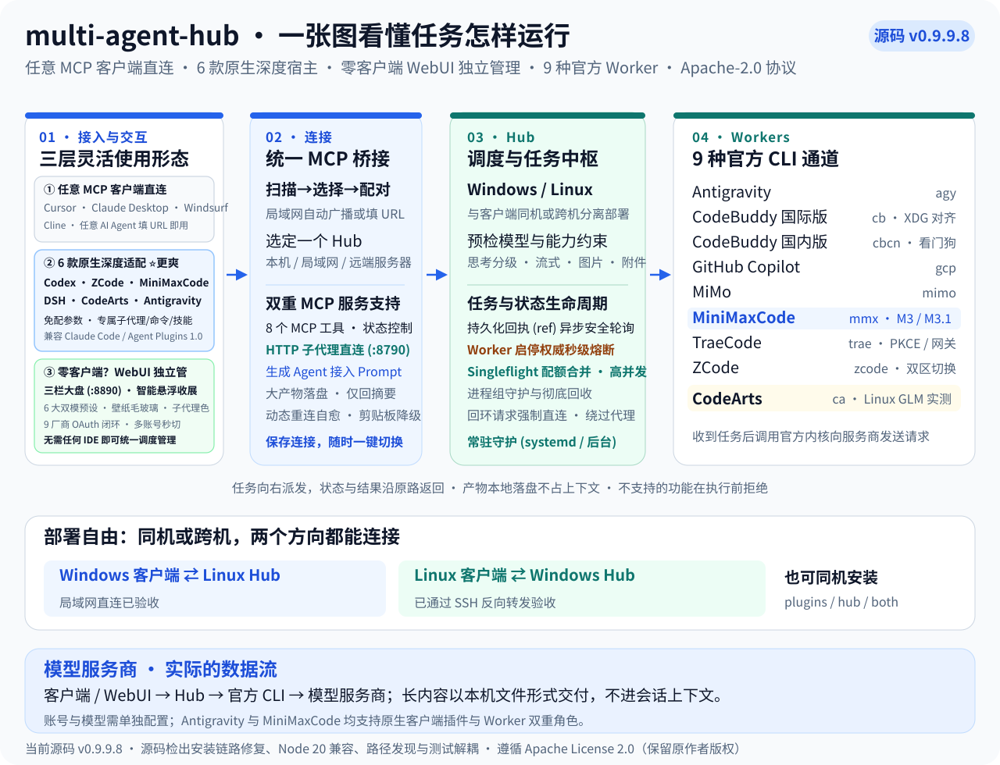
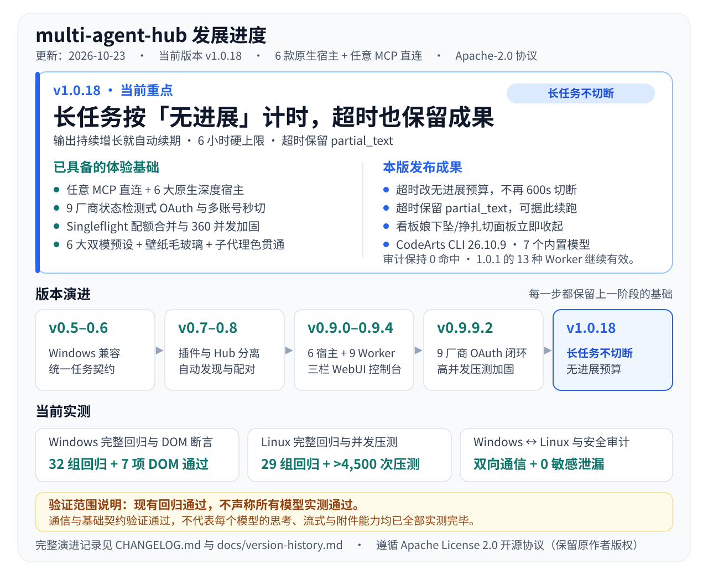

# multi-agent-hub

[English](README.en.md) · **简体中文**



**multi-agent-hub** 是一个面向多开发环境的 AI Agent 统一调度中枢。它基于标准 MCP 协议、原生插件与子代理体系，为 9 种主流 AI 编码 Worker 与 6 款原生深度宿主（外加任意 MCP 客户端）提供统一的任务派发、结果回传、配额监控、账号管理与零客户端 WebUI 管理大盘，具备三层灵活接入形态：
1. **任意 MCP 客户端直连即用**：任何支持标准 MCP 协议的客户端（如 Cursor、Claude Desktop、Windsurf、VS Code Cline/Roo Code、Continue 等），仅需配置 Hub 的 MCP URL（或使用内置一键复制的 Prompt 指令），即可直接调度多端 Worker；
2. **6 款原生宿主深度适配（体验更顺畅、更舒服）**：针对 **Codex**、**ZCode**、**MiniMax Code（及 Claude Code / Agent Plugins 1.0）**、**DeepSeek Harness (DSH)**、**华为 CodeArts** 与 **Antigravity** 提供了深度定制的原生插件、专用子代理体系（`hub-*.md`）、专属技能与斜杠命令，上下文自动隔离，免去手动配置参数的繁琐；
3. **零客户端独立使用**：即使没有外部 IDE 或 AI 客户端，Hub 内置的 **CodeBuddy 风格三栏式 WebUI 管理大盘** 也能独立完成平台多会话树管理、沉浸式对话、任务派发与监控、全量会话归档复原与彻底清理。

当前源码版本为 **0.9.9.6**，本阶段（v0.9.9.3 ~ v0.9.9.6）在完成 **9 Worker 登录链路状态检测化重构与真实凭据对齐** 的基础上，重点聚焦 **WebUI 控制台 UI/UX 体系化打磨、自定义壁纸全局毛玻璃通透体系、三向智能悬浮收展引擎与侧栏净空精简**：新增左上角常驻品牌锚点（`.brand-logo-pin`，点击可切换自动收展/常驻并持久化）与顶栏/活动栏/平台侧栏光标感知智能收展引擎（对话侧栏展开时活动栏联动常驻防跳动，触发热区统一扩展至侧栏完整占位宽度）；将主题预设扩充为 **Mocha、Shell、Aurora（极光微光）、Dusk（暮霭流金）、Cyber（赛博深空）、Grid（科技网格）** 共 6 套完整深/浅双模调色板（12 种组合，通过 WCAG AA 高对比度校准），并在自定义壁纸或高定预设下启用全局 Glassmorphism 毛玻璃通透体系与基础中性灰面统一（残留灰面元素 96 → 0，保留 `--gem-surface-high` 承载交互态与进度条轨道）；实现发送按钮、上下文进度条及对话区全部二级菜单对当前子代理品牌色（`--agent-accent`）的全链路贯通，而模型名称等资讯文字严格保持正文标准色（`--gem-text`）；完成侧栏卡片单行化精简（移除冗余待机占位行、放大镜图标、⌘K 提示与超宽胶囊，确保「N会话」徽标完整无裁切）并推出包含内存虚拟驱动引擎的单文件零依赖脱机交互 Demo（`demo.html`）。

---

### ✨ 核心亮点

- 🔌 **6 大原生宿主客户端**：深度适配 Codex、ZCode、MiniMax Code（兼容 Claude Code / Agent Plugins 1.0）、DeepSeek Harness、CodeArts、Antigravity，提供原生子代理、斜杠命令与工作流。
- 🤖 **9 种 Worker 统一适配**：标准契约调度 Antigravity、CodeBuddy（国际/国内版）、GitHub Copilot、MiMo、MiniMax、TraeCode、ZCode、CodeArts（Antigravity 原生客户端为新增宿主角色，不作为第十种 Worker）。
- 🎛️ **CodeBuddy 风格三栏式交互控制台与智能悬浮收展**：内置 Web 管理大盘（`--with-console`，端口 `8890`，默认监听 `0.0.0.0` 开放局域网访问），提供极窄活动栏、平台会话管理树、单平台沉浸式对话（一体化毛玻璃输入壳体 `.chat-composer-shell` + 左右贴靠自适应模型/思考/流式配置浮层）与右侧可折叠扩展工作台；左上角配备永不隐藏的品牌锚点 `#brand-logo-pin`，支持顶栏（`Y ≤ 38px`）、活动栏（`X ≤ 42px`）与平台侧栏（全宽热区）的光标存在感知平滑收展与防误触缓冲（弹窗打开、输入聚焦或会话侧栏展开时自动锁定防误收）；支持 7 大时段 35 句智能问候语、跨平台全局头像自由替换、全量会话归档筛选/复原/**右上角二次确认一键清空**及全网络环境剪贴板降级兼容。
- 🎨 **6 大深浅双模色系预设、自定义壁纸毛玻璃与子代理主题色贯通**：内置 Mocha、Shell、Aurora、Dusk、Cyber、Grid 六大色系预设（均配备完整深色/浅色双模调色板与 CSS 变量化渐变底图，浅色状态栏面板对比度高达 14.27:1 ~ 15.27:1）；应用自定义壁纸或高定预设时，顶栏、会话头、Composer 输入台、消息气泡、侧边栏与右侧工作台全面切换为半透明毛玻璃态（`backdrop-filter: blur(20px~24px) saturate(180%~190%)`），基础中性灰面统一并入卡片色号 `--gem-bg-card`；发送按钮、上下文进度条内条及对话区二级菜单动态跟随所选子代理主题色（`--agent-accent`），模型标签文字统一采用问候语标准正文色（`--gem-text`）。
- 🖥️ **零依赖单文件交互 Demo**：内置 `scripts/build_demo.py` 与内存虚拟驱动引擎 `demo_engine.js`，一键打包生成单文件纯前端交互演示页（`demo.html` / `demo/index.html`），无需后端服务即可脱机完整体验三栏控制台、多主题切换与模拟调度交互。
- 🔐 **9 Worker 全量 WebUI OAuth 登录、状态检测收口与多账号秒切**：所有 9 个 Worker（`minimaxcode`、`codebuddy`、`codebuddy-cn`、`github-copilot`、`antigravity`、`mimocode`、`traecode`、`zcode`、`codearts`）均可在 WebUI「配额与账号」面板内**免 SSH 终端完成 OAuth 授权登录、退出登录、当前账号档案保存（完整支持中文/Unicode 备注名）、44ms 乐观 UI 多账号秒切与隔离沙盒添加账号**；采用真实凭据落盘状态检测（杜绝假成功），对齐 CodeBuddy 新版 XDG 共享会话存储与官方 state 兑换看门狗、Trae 官方 PKCE 授权、ZCode 国内/国际双区切换、MiMo API Key 与账号身份分离及登录会话取消进程回收（`POST /api/auth/cancel`）。
- 🚀 **子代理原生 HTTP MCP 直连端点**：提供轻量内置 HTTP MCP Server（默认端点 `http://127.0.0.1:8790/mcp`），向任意 AI 客户端（Cursor / Claude Desktop / Antigravity / Windsurf / Cline 等）开放 `subagent_run`（大产物本地落盘、只回摘要不占会话上下文）、`subagent_result`、`subagent_artifact`、`subagent_agents` 调度；控制台一键复制 MCP URL 与**【复制本文（发给Agent配置）】**，直接粘贴发给 Agent 即可全自动接入。
- ⚡ **子代理启用开关与全端双向同步**：在 WebUI 控制台对任意 Worker（如暂时无额度或调试中的子代理）一键启停；权威状态即时同步落盘并由 Hub 调度器、WebUI 与所有客户端插件实时感知；被禁用的 Worker 在 `hub_status` 显式呈现 `[已禁用]`，派发时零延迟前置拦截（`profile_disabled`），杜绝浪费计算与配额资源。
- 🎯 **精炼去重的生产模型目录**：为各 Worker 对齐官方真实模型与积分倍率体系，全面清理无法用于代码任务的生图模型、冗余平台别名与旧代模型，保留各服务商当季旗舰与高可用选型（如 MiniMax-M3 1M 上下文与 M3.1-Flash-Preview 512K 上下文一键切换、自定义模型别名逐个可删等）。
- 🔄 **灵活多样的部署形态**：插件与 Hub 支持同机共存或分离部署；支持纯 Windows、纯 Linux 及 Windows ↔ Linux 跨机连接（局域网直连或 SSH 反向通道）。客户端连接特定 Hub 并非多 Hub 联邦，模型请求仍由官方 CLI 发送至服务商。
- 🛡️ **严格能力预检与终态判定**：根据模型能力约束思考、流式与附件；CodeArts 宿主环境强制执行 `tool_search → tool_describe → tool_call` 单一调用路径与单任务单次派发；拒绝空回答、已知异常退出及 agy 超时后的部分回答；保留原任务回执（ref），阻止 worker 向自身重复派发。
- 🔍 **智能发现与平滑切换**：局域网与本机 Hub 自动广播扫描与手动回退；MCP 桥接支持配置恢复后动态重连自愈；连接配置与凭据独立于源码，平滑升级不丢失历史任务数据。

---

## 原生客户端接入与实测状态

各客户端通过专属原生插件接入调度中枢：

- **Antigravity 原生插件**：提供 `plugin.json`、9 个代理（`agents/*.md`）、4 个技能（`skills/*/SKILL.md`）及包含 8 个桥接工具（含 `hub_set_status`）的 `mcp_config.json`。可选 Python SDK 锁定 `google-antigravity==0.1.21`，提供强类型 `SubagentConfig` 与 Python 串并行编排能力；注意已安装 wheel 不包含 `beta.run_workflow` API，且 SDK API 鉴权独立于 IDE/CLI 登录（缺少 SDK 鉴权时 SDK 编排模型调用受阻）。
- **CodeArts 原生插件与驱动**：包含 9 个子代理、3 个斜杠命令、1 个调度技能、1 个 Hooks 插件和 8 个 MCP 工具。双向支持客户端调度与 Worker 被调度（`worker="codearts"`，别名 `ca`、`huawei-codearts`）。
  - **IDE 懒加载工具协议深度适配与单一路径约束**：支持 CodeArts IDE 动态工具注册体系；严格确立 `tool_search` 发现工具 → `tool_describe` 获取参数 Schema → `tool_call` 执行的**单一标准路径**；严禁在 Markdown 或纯文本推理中直出 XML 标签，杜绝引擎双重派发；任务单次派发后由客户端安全轮询。
  - **权限管控与终态轮询保障**：遇宿主权限拒绝（Permission Denied / auto-rejecting）时立即终止并返回 `blocked_permission` 与原始 ref，禁止换工具名或经父代理重试；在等待预算内以原 ref 持续轮询 `hub_fetch`，严格以符合验收条件的非空真实 worker 回答判定 `completed`，绝不以会话结束或工具调用成功冒充任务完成。
  - **Windows 官方 CLI 精准识别与环境隔离**：精准识别官方 `installers/bin/codearts.exe`，采用独立 `cli-data` 隔离目录与独立会话数据库，不再与 IDE GUI AgentKernel 混淆；继承外部认证并保持 TLS 校验；将“文件夹未被信任”准确归类为 `CODEARTS_PERMISSION_REQUIRED` 脱敏提示。
  - **Linux 进程生命周期与资源回收加固**：驱动与 Hub 统一进程组管理，确保任务取消与超时时彻底回收所有后代进程，杜绝孤立进程残留。

| 验证项目 | 实际结果 | 状态说明 |
| --- | --- | --- |
| Windows 回归测试 & DOM 断言 | ✅ 通过 (32组 + 7项 DOM) | 32/32 组回归测试全量通过（见 `docs/refactor-validation.json`），WebUI 布局/主题/毛玻璃/侧栏精简 DOM 断言 `tests/console_layout_theme_dom.mjs` 7/7 通过；非全量付费模型实测证明 |
| Linux 回归测试 & 压测 | ✅ 通过 (29组 + >4,500次压测) | 360 并发洪峰 0 报错（`/health` P95 1.25s）、60 并发配额 Singleflight 合并（P95 850ms）、100KB 大任务 + 30 并发状态机零损坏（见 `docs/stage3-stress-report.json`、`docs/stage4-5-load-report.json`、`docs/stage6-compat-report.json`） |
| Linux 生产 Hub 0.9.9.6 | ✅ 通过 | 暴露 24 个 Hub 工具与 9 种 worker，内置原生 9 厂商配额监控、多账号切换与 v0.9.9.6 智能收展/毛玻璃 WebUI 大盘，已有配置、任务历史与鉴权平滑保留 |
| Linux Antigravity CLI 1.3.1 | ✅ 真实调用通过 | gemini-3.8-flash-medium 精确标记通过，插件模式校验通过（4技能/9代理/1MCP）；真实模型调用 `hub_status` 成功返回 9 种 worker，完整原生子代理 `hub-mimocode` 派发成功（返回 `ref=mimocode-79e2416c91`，`completed`，`answer=95`） |
| Linux ZCode CLI 0.16.9 | ✅ 真实调用通过 | 原生 `agenthub-workers:mimocode` 子代理经插件派发，原 ref 续查返回 `73` |
| Windows Codex / ZCode | ✅ 真实调用通过 | 两种原生子代理分别返回 `2117`、`2077`；初轮长标记回答不完整的记录也保留 |
| Windows DSH | ⚠️ 账号余额受阻 | 10 个预设、7 个 MCP 工具及工作流注册通过；实际模型调用返回 `402 ACCOUNT_QUOTA` |
| Windows Antigravity | ✅ 真实调用通过 | 修复本地 client.json 缺失与 MCP 连接动态重试机制；实测通过 hub_status / hub_capabilities 实时返回 9 种 Worker 在线与能力状态 |
| Linux Codex & DSH CLI | ❌ 未安装 (not_installed) | Linux 实机未找到 CLI 可执行文件，未执行实测，不作通过宣称 |
| CodeArts 原生组件与通道 | ✅ 通过 | Windows 正式内核识别组件；Linux CLI 原生文件及 MCP 已安装校验通过；Windows ↔ Linux 局域网直连与 SSH 通道建立正常 |
| Windows CodeArts IDE | ⚠️ 原生派发通过，结果回收受权限限制 | DeepSeek v4.1 Flash 真实调用 `hub-mimocode`，唯一回执 `mimocode-d5f1337f8a`；Linux 实际答案为 `45`，但 IDE 后续 `hub_fetch` 被宿主拒绝，不计为完整验收 |
| Linux CodeArts 自身模型调用 | ✅ 官方模型真实任务秒级通过 | 自动加载凭据环境；显式 GLM-5.2 与 GLM-5.2-ArkTS-SPARK 派发秒级返回完成，回执真实有效，核验 driver 与 CLI 共用进程组，完成后所属进程全部安全退出 |
| Windows 独立 CodeArts CLI | ⚠️ 尚未通过模型验收 | 已修复官方 exe 发现及 CLI 专用配置；独立目录探针受到文件夹信任限制，不替代已登录 IDE 的使用状态 |

> **边界与差异说明**：
> 1. **回归测试 ≠ 全量付费实测**：Windows 32 组与 Linux 29 组回归通过为框架逻辑与离线回归，不能视为每个服务商、模型或原生宿主均已跑通真实付费任务。
> 2. **原生插件 vs 可选 Python SDK**：Antigravity 原生插件基于声明式配置直接接入 MCP 桥与子代理，已跑通真实模型调用与原生子代理派发；而可选 Python SDK 为外部编排库，当前 wheel 无 `beta.run_workflow`，且其 API 鉴权与宿主登录隔离。
> 3. **实机未安装环境如实报告**：Linux 实机未安装 Codex 与 DSH CLI，标记为 `not_installed`，不虚报通过。
> 4. **CodeArts 鉴权与调用边界**：IDE 登录不代表独立 CLI 具备调用条件，其他服务的登录态也不能替代华为账号权限。当前 worker 仅开放默认思考与非流式文本；未生效的配置不会替换用户原默认模型。
> 5. **本地与网络隐私**：客户端选定单个 Hub 并非跨 Hub 联邦；提示词与附件在调用对应 worker 时仍会发送至官方模型服务商。

完整任务回执、源码哈希、失败记录及修复后两端各 83 项增量检查见 [0.9.9 验收记录](docs/release-0.9.9.md)。

CodeArts 的 IDE 优先适配、官方认证修复及后续测试见 [2026-10-10 跟进记录](docs/codearts-ide-followup.md)。这些修复属于发布后跟进，原 `v0.9.9` 标签及已构建 ZIP 保留原内容。

示例：仅安装 CodeArts 客户端并连接远端 Hub：

```powershell
# Windows
.\install.cmd --component plugins --native-hosts codearts --project C:\Work\my-project --url http://SERVER:8765/mcp --token-file C:\private\hub-token.txt
```

```bash
# Linux
./install.sh --component plugins --native-hosts codearts --codearts-target cli --url http://SERVER:8765/mcp --token-file /private/hub-token.txt
```

*注：IDE 的 `--project` 应指向实际打开的工作区，亦可用 `--codearts-ide-settings` 指定 MCP 配置文件。未指定时会自动标为待配置。安装完成后请重载 IDE 或重启 CLI。详见 [CodeArts 原生包文档](integrations/codearts/README.md)。*

### CodeArts 换工作区后连接 Hub

CodeArts IDE (26.9.501) 按当前工作区加载 `.codeartsdoer/mcp/mcp_settings.json`。切换新项目时，无需重新输入 Hub Token 或启动本机 Hub，直接复用外部 `client.json` 即可一键登记：

```powershell
# 针对当前新工作区登记 IDE MCP 设置
python integrations/codearts/install.py --config "$env:LOCALAPPDATA/AgentHub/client.json" --ide-settings "C:/Work/new-project/.codeartsdoer/mcp/mcp_settings.json" --target ide --apply
```

登记后在 IDE 中执行“开发人员：重新加载窗口”，即可通过 `/hub-status` 验证连接与 Worker 可用性。详见 [CodeArts 原生包文档](integrations/codearts/README.md#换工作区后连接-hub)。

---

## 🚀 快速上手与一键安装 (Quick Start)

为满足不同开发者的使用习惯，项目提供极简的场景化接入方案：

```text
┌────────────────────────────────────────────────────────────────────────┐
│                        按需选择最适合你的安装方式                       │
├────────────────────────────────────────────────────────────────────────┤
│ 0. 懒人最爱 · 发一句话给 Agent → 复制下方提示词，让你的 AI 自动帮你装好！ │
│ 1. 最省心 · 本机一键安装      → 双击 install.cmd / bash install.sh      │
│ 2. 任意 AI 客户端直连        → 填入 http://127.0.0.1:8790/mcp (10 秒接入)│
│ 3. 跨机部署 (服务器+个人端)    → 服务端跑 Hub，客户端连过来 (局域网/SSH)   │
│ 4. 6 大原生宿主按需单装      → CodeArts/MiniMax/ZCode/Codex/DSH/AGY   │
└────────────────────────────────────────────────────────────────────────┘
```

---

### 🤖 方案零：零动手 · 复制一句话发给你的 AI Agent 自动配置（最推荐 ⭐⭐⭐⭐⭐）

不用自己记命令或找配置文件，根据你正在使用的客户端类型，**直接复制下面对应的一句话发送给你的 AI 助手**，让它全自动帮你完成克隆、安装与配置：

#### 🅰️ 第一类：6 大原生深度适配客户端（自动安装专属子代理 + 技能 + 命令）

- **🌟 原生宿主通用一句话（适合 Antigravity / CodeArts / ZCode / Codex / DSH / MiniMax Code）**：
  ```text
  请帮我克隆 https://github.com/Johhny-Xu/multi-agent-hub.git 到本地，阅读其中的 README.md，根据我当前所在的客户端环境执行对应的 install.cmd（Windows）或 ./install.sh（Linux/macOS）完成 Multi-Agent Hub 服务与当前客户端原生深度插件（子代理、Skills 与 MCP 桥）的安装配置，并调用 hub_status 验证连接状态。
  ```

- **🎯 分客户端精准一句话（按需复制对应客户端那一行）**：
  - **发给 Google Antigravity**：
    ```text
    请帮我克隆 https://github.com/Johhny-Xu/multi-agent-hub.git，运行 install.cmd（Linux 用 ./install.sh）并指定 --native-hosts antigravity，把 Multi-Agent Hub 原生插件与 9 个 hub-* 子代理安装到 ~/.gemini/config/plugins/multi-agent-hub 并启动 Hub 服务。
    ```
  - **发给 华为 CodeArts (IDE / CLI)**：
    ```text
    请帮我克隆 https://github.com/Johhny-Xu/multi-agent-hub.git，为当前工作区执行 install.cmd --native-hosts codearts --project <当前项目路径>（Linux 用 ./install.sh），完成 Multi-Agent Hub 服务与当前工作区 .codeartsdoer/mcp/mcp_settings.json 及专属子代理的自动注册。
    ```
  - **发给 MiniMax Code (`mcode`) / Claude Code**：
    ```text
    请帮我克隆 https://github.com/Johhny-Xu/multi-agent-hub.git，启动其中的 Multi-Agent Hub 服务，并将仓库内的 plugins/agenthub-workers 目录作为原生插件（含 .minimax-plugin/plugin.json、.claude-plugin/plugin.json、hub-bridge.mcp.json 与 dispatch-hub 技能）加载配置到当前客户端中。
    ```
  - **发给 ZCode (IDE / CLI)**：
    ```text
    请帮我克隆 https://github.com/Johhny-Xu/multi-agent-hub.git，运行 install.cmd --native-hosts zcode（Linux 用 ./install.sh），将 plugins/agenthub-workers 原生插件（含 9 个外部 Worker 子代理与 MCP 桥）注册到我的 ZCode 环境中并启动 Hub。
    ```
  - **发给 OpenAI Codex**：
    ```text
    请帮我克隆 https://github.com/Johhny-Xu/multi-agent-hub.git，针对当前项目工作区运行 install.cmd --native-hosts codex --project <当前项目路径>（Linux 用 ./install.sh），自动配置 Codex 原生插件市场与 .codex/agents/ 路由规则。
    ```
  - **发给 DeepSeek Harness (DSH)**：
    ```text
    请帮我克隆 https://github.com/Johhny-Xu/multi-agent-hub.git，运行 install.cmd --native-hosts dsh（Linux 用 ./install.sh）或通过 dsh plugin add file:./integrations/dsh 挂载原生预设与工作流插件。
    ```

#### 🅱️ 第二类：任意通用 MCP 客户端（Cursor / Windsurf / Claude Desktop / Cline / Roo Code / Continue 等）

- **🌐 已有运行中的 Hub（本机或局域网）· 10 秒接入一句话**：
  ```text
  请帮我在当前客户端的 MCP 配置文件中添加名为 "multi-agent-hub" 的 Streamable HTTP MCP 服务，URL 为 http://127.0.0.1:8790/mcp（若为局域网服务器请替换为对应 IP），配置完成后调用 subagent_agents 工具查看当前可用的外部子代理列表。
  ```
- **🛠️ 从零开始（让通用客户端自动克隆 + 启动服务 + 写入 MCP 配置）一句话**：
  ```text
  请帮我克隆 https://github.com/Johhny-Xu/multi-agent-hub.git，执行里面的 install.cmd（Linux 用 bash install.sh）启动 Multi-Agent Hub 与 Web 控制台服务（:8890 / :8790），然后把 http://127.0.0.1:8790/mcp 自动写入我当前客户端的 MCP 配置文件中。
  ```

---

### 方案一：最省心 · 本机一键安装（开箱即用，推荐 ⭐⭐⭐⭐⭐）

> **适合场景**：在单台电脑（Windows 或 Linux）上进行开发，希望一键配齐 Hub 服务、WebUI 控制台及已有的 IDE 插件。

#### 步骤 1：获取项目代码
- **方式 A（Git 克隆，获取最新 v0.9.9.6 源码，推荐）**：
  ```bash
  git clone https://github.com/Johhny-Xu/multi-agent-hub.git
  cd multi-agent-hub
  ```
- **方式 B（下载 Release 打包）**：
  从 [Releases](https://github.com/Johhny-Xu/multi-agent-hub/releases) 下载最新预构建包（如 `agenthub-0.9.9.6-both.zip`）并解压。

#### 步骤 2：一键执行安装并启动
- **Windows**：直接双击根目录 **`install.cmd`**（或在终端运行 `.\install.cmd`）；
- **Linux**：在终端执行 **`bash install.sh`**。

> 💡 **全自动诊断与注册**：安装器会自动检查环境、安装 Hub 服务与 Web 控制台，并自动探测注册当前机器上的 Codex、ZCode、DSH、CodeArts、Antigravity 原生插件与专属子代理。

#### 步骤 3：立即开始使用
- 浏览器访问 **`http://localhost:8890`**，即可直接进入三栏式 Web 控制大盘（或直接双击打开仓库内的 `demo.html` 脱机体验完整前端交互）；
- 或在您已安装的 IDE 中，直接呼出子代理开始对话派发；
- **日常启停控制**：日常使用可直接双击或运行 `start.bat`（Linux：`bash start.sh`），停止运行 `stop.bat`（Linux：`bash stop.sh`）。

---

### 方案二：免装插件 · 任意 AI 客户端 10 秒接入（MCP 直连 ⭐⭐⭐⭐⭐）

> **适合场景**：使用 Cursor、Claude Desktop、Windsurf、VS Code (Cline / Roo Code / Continue) 等任意支持 MCP 的宿主，无需安装任何扩展或插件。

只需在本机启动 Hub 服务后，将标准 HTTP MCP 端点提供给客户端：

- **MCP 端点**：`http://127.0.0.1:8790/mcp`
- **更舒服的方式**：打开 Web 控制台（`http://localhost:8890`），在“子代理接入端点”卡片直接点击 **【复制本文（发给Agent配置）】**，把复制出的提示词直接发给 AI 助手，Agent 将自动帮你写入客户端的 MCP 配置文件！
- **手动 JSON 配置参考**：
  ```json
  {
    "mcpServers": {
      "multi-agent-hub": {
        "url": "http://127.0.0.1:8790/mcp"
      }
    }
  }
  ```

---

### 方案三：跨机器部署（服务端与客户端分离）

> **适合场景**：在家庭服务器、NAS 或云服务器（Linux / Windows）上集中运行 Hub 和 9 种 CLI Worker，在另一台个人电脑上编写代码。

#### 步骤 A：服务端安装并启动 Hub
```bash
# 在服务端执行，监听局域网地址并开启 Web 控制台
bash install.sh --component hub --bind 0.0.0.0 --port 8765 --with-console
```
*注：安装器会自动生成外部强随机连接安全令牌文件 `hub-token.txt`。*

#### 步骤 B：客户端安装原生插件并配对连接
```powershell
# Windows 客户端指定目标服务器与 Token 完成配对
.\install.cmd --component plugins --url http://SERVER_IP:8765/mcp --token-file C:\private\hub-token.txt
```
- **自动广播发现**：客户端初次安装若未指定 `--url`，会自动通过 UDP 广播扫描局域网内的候选 Hub，交互式选择即可完成配对；
- **随时重选 / 切换 Hub**：后续在客户端运行 `connect.cmd`（Linux: `./connect.sh`），即可重新发现或切换目标 Hub；
- **SSH 反向通道**：两台机器不在同一局域网时，可通过 SSH 反向映射端口（例如 `ssh -N -R 127.0.0.1:18765:127.0.0.1:8765 user@SERVER`）穿透内网。
- **Linux 常驻守护**：Linux Hub 服务可加 `--systemd-user` 参数注册为标准用户级 systemd 后台服务。

---

### 方案四：6 大原生宿主独立插件按需导入 / 单独安装

> **适合场景**：只需要为某一款特定 IDE / CLI 客户端单独导入或注册原生插件（含专属子代理 `hub-*.md`、技能 `SKILL.md`、斜杠命令与工作流）。

| 原生宿主客户端 | 独立导入 / 按需单装方式 | 插件目录与详细说明 |
| --- | --- | --- |
| **1. 华为 CodeArts / VS Code** | • **图形扩展**：在 IDE“扩展”面板选择“从 VSIX/CARTS 安装...”，导入 `multi-agent-hub-0.9.9.6.carts` 或 `.vsix`<br>• **命令行注册**：`.\install.cmd --component plugins --native-hosts codearts --project <工作区路径>` | [`integrations/codearts`](integrations/codearts/README.md) & [`integrations/vscode`](integrations/vscode/README.md) |
| **2. MiniMax Code / Claude Code** | • **桌面端 / 云端插件包（MiniMax Plugin V1）**：直接导入 `agenthub-workers-0.9.9.6-minimax-plugin.zip`（含 `.minimax-plugin/plugin.json`）<br>• **CLI (`mcode` / `claude`)**：`mcode --plugin-dir ./plugins/agenthub-workers`（含 `.claude-plugin/plugin.json` 与 Agent Plugins 1.0 `plugin.json`） | [`plugins/agenthub-workers`](plugins/agenthub-workers/README.md) |
| **3. ZCode IDE / CLI** | • **命令行自动注册**：`.\install.cmd --component plugins --native-hosts zcode`<br>• **IDE 发现页 / 本地配置**：在 ZCode 插件发现页添加本仓库，或在 `zcode.json` 配置 `{"plugins":{"enabled":true,"dirs":[".../plugins/agenthub-workers"]}}` | [`plugins/agenthub-workers`](plugins/agenthub-workers/README.md) |
| **4. OpenAI Codex** | • **命令行自动注册**：`.\install.cmd --component plugins --native-hosts codex --project <工作区路径>`<br>• 自动注册本地插件市场并将 9 个子代理与工作流写入目标工作区 `.codex/agents/` | [`integrations/codex`](integrations/codex/README.md) |
| **5. DeepSeek Harness (DSH)** | • **命令行自动注册**：`.\install.cmd --component plugins --native-hosts dsh --profile agenthub-client`<br>• **手动 Bundle 挂载**：`dsh plugin --profile <PROFILE> add file:./integrations/dsh --ignore-scripts` | [`integrations/dsh`](integrations/dsh/README.md) |
| **6. Google Antigravity** | • **命令行自动注册**：`.\install.cmd --component plugins --native-hosts antigravity`<br>• 自动将原生插件（Skills + 9 个 `hub-*` 子代理 + MCP 桥）安装至 `~/.gemini/config/plugins/multi-agent-hub`，重启 Antigravity 生效 | [`integrations/antigravity`](integrations/antigravity/README.md) |

---

### 📦 预打包文件与运行依赖

> *注：下表为 `v0.9.9.6` 的预打包产物，与当前源码版本号一致；也可直接通过 `python packaging/build.py --output <目录> --component all` 按源码自行构建。*

| 安装包 | 适用环境 | 包含内容 |
| --- | --- | --- |
| **agenthub-0.9.9.6-both.zip** | 客户端与 Hub 均在同一机器运行（最推荐） | 包含全部组件、安装向导、服务管理脚本 |
| **agenthub-0.9.9.6-plugins.zip** | 仅用于编写代码的客户端电脑 | 多宿主客户端原生插件、MCP 桥接器、子代理与工作流 |
| **agenthub-0.9.9.6-hub.zip** | 仅运行 Worker 与模型的服务端机器 | Python Hub 服务、9 种 Worker 适配驱动、可选 WebUI 控制台 |
| **agenthub-workers-0.9.9.6-minimax-plugin.zip** | MiniMax Code 桌面端 / MiniMax Agent 云端 / Marketplace | 符合 MiniMax Plugin V1 规范的零包裹层独立插件包 |
| **multi-agent-hub-0.9.9.6.carts / .vsix** | 华为 CodeArts IDE、VS Code 及兼容编辑器 | 桌面端图形扩展：一键导入、侧边栏面板、状态指示灯 |

- **运行依赖要求**：
  - **基础运行环境**：Python 3.8+（Codex 代理安装需 Python 3.11+）；Node.js 20+（用于 MCP 桥接与 Web 控制台）；
  - **Worker 模型环境**：依赖各对应服务商的官方 CLI（如 `agy`、`cb`、`trae`、`codearts` 等）及其官方登录态，安装器仅负责环境探针与指令调用，不包含账号注册与自动登录。
- 更多详细高级参数见 [安装包构建与完整参数说明](packaging/README.md)。

---

## Web 控制台与管理大盘 (Console & WebUI)

Hub 提供内置的轻量化现代 Web 管理大盘（在安装或启动时指定 `--with-console` 即可开启，默认运行在 Node.js 服务端口 `8890`，监听 `0.0.0.0` 开放局域网访问）：

- 🎛️ **CodeBuddy 风格三栏式交互大盘与智能悬浮收展引擎**：
  - **左上角常驻品牌锚点 (`#brand-logo-pin`)**：固定于左上角（`z-index: 120`）永不隐藏，点击即可一键切换顶栏与活动栏的「自动收展 / 常驻锁定」模式并持久化至本地存储，双收起状态下自动追加安全避让边距；
  - **顶栏与极窄活动栏智能收展**：提供「对话 / 设置」极简双主视图切换（内聚子代理与配额中枢、任务队列与跨代理共享笔记），移动端自适应下沉底部导航栏；桌面端光标移至顶边（`Y ≤ 38px`）或左边（`X ≤ 42px`）经 90ms 防误触识别后平滑展开，离开后 650ms 防抖自动收起进入沉浸式专注模式，且在平台会话侧栏展开或弹窗/输入焦点激活时自动保持常驻不跳动；
  - **平台会话管理树与单行化精简**：光标进入左侧侧栏完整占位区域（`1440px` 视口下 `X ≤ 324px`）即自动滑出展开；移除无内容的「待机 · 点击开启对话」占位行实现卡片单行化（有异步智能摘要或最后消息时按需动态挂载 `/api/chat/agent-summary`），移除搜索框放大镜图标与 ⌘K 提示、收敛额度/缓存胶囊，确保「N会话」徽标在全 9 张卡片上 100% 完整无裁切展示；
  - **沉浸式中央交互区**：对话头采用「子代理头像（点击切换 9 子代理）｜当前会话名（点击切换对话）」一体胶囊，「新建 / 清空 / 导出」收进「⋯」溢出菜单，右侧保留「工作台」独立按钮（窄屏下禁止自动全宽遮挡对话，改由边缘把手提示）；顶栏（`z-index: 100`）与会话头（`z-index: 50`）赋予独立层叠上下文，彻底杜绝下拉菜单被代码块或工作台截断。
- 🎨 **6 大深浅双模色系预设、自定义壁纸毛玻璃与子代理主题色贯通**：
  - **6 套完整深/浅双模调色板**：内置 **Mocha**（`#1e1e2e` / Latte `#eff1f5`）、**Shell**（`#0f0f11` / Paper `#f8f9fa`）、**Aurora 极光微光**（`#0B0F19`）、**Dusk 暮霭流金**（`#18121D`）、**Cyber 赛博深空**（`#070913`）、**Grid 科技网格**（`#0A0F1E`）6 大预设共 12 种深浅配色组合，渐变底图收敛为 CSS 变量随深浅主题自动切换，浅色主题下状态栏配置面板文字对比度达 `7.99:1 ~ 15.27:1`（远超 WCAG AA 标准）；
  - **自定义壁纸全局毛玻璃通透体系 (`body.has-custom-bg`)**：上传本地/网络壁纸或选用 Aurora/Dusk/Cyber/Grid 预设时，顶栏、会话头、Composer 输入台、用户消息气泡、侧边栏与右侧工作台全面自适应切换为半透明毛玻璃态（`backdrop-filter: blur(20px~24px) saturate(180%~190%)`）；基础中性灰面全量统一并入卡片色号 `--gem-bg-card`（残留灰面元素由 96 降至 0），仅保留 `--gem-surface-high` 作为交互态、配额进度条轨道与选中行底色载体；
  - **子代理主题色贯通 (`--agent-accent`)**：切换子代理时，发送按钮深色渐变背景、上下文进度条内条以及 `#panel-chat` 对话区全部二级菜单（模型与运行参数弹窗徽标/选中行色条/勾选/思考档位/完成按钮、状态栏显示项弹窗、会话头二级菜单图标、输入框焦点描边等）实时联动跟随子代理品牌色；输入框下方模型胶囊与状态栏模型名则严格保持问候语正文色 `var(--gem-text)`，兼顾品牌辨识度与阅读舒适度。
- 🖥️ **单文件零依赖交互 Demo (`demo.html`)**：
  - 通过 `scripts/build_demo.py` 与内存虚拟驱动引擎 `demo_engine.js` 打包生成单文件纯前端交互 Demo（同步输出至 `demo.html` 与 `demo/index.html`），无需启动 Node/Python 后端即可在任意浏览器脱机体验完整 UI/UX 与虚拟任务交互。
- 📦 **全量会话归档聚合与一键批量删除**：
  - 支持跨所有平台聚合历史归档，将平台筛选与排序整合为单漏斗图标菜单（支持按项目/时间线视图及更新时间/创建时间排序）、支持输入框实时模糊搜索；
  - 支持会话一键复原至活跃对话树（自动定位并打开）、单条永久删除，以及右上角**【一键删除】与防误触内联二次确认**；打开某 Agent 对话时自动将该 Agent 下全部会话未读红点清零。
- 🚀 **子代理原生 HTTP MCP 直连端点与配置生成**：
  - 自带轻量内置 HTTP MCP Server（默认端点 `http://127.0.0.1:8790/mcp`），向任意 AI 宿主开放 `subagent_run`（服务端等待结果，超长产物落盘本地并只返回摘要，不占用会话上下文）、`subagent_result`、`subagent_artifact`、`subagent_agents` 四大核心工具；
  - 控制台提供**【复制 MCP URL】**与**【复制本文（发给Agent配置）】**，一键生成包含工具清单、JSON 接入配置模板与调用引导的完整提示词，直接发给任意 AI Agent 即可全自动完成 MCP 登记。
- 📋 **全网络环境剪贴板健壮回退**：
  - 针对局域网 IP（非安全上下文 `window.isSecureContext=false`）下现代浏览器对 `navigator.clipboard` 的静默拦截，实现原生 Textarea 与 ExecCommand 多层回退保障，全端全环境复制 100% 成功。
- 🔘 **Worker 一键激活/禁用开关与多账号乐观切换**：
  - 每个 Worker 卡片内置原生启用切换开关，状态即时持久化落盘至 `agents.json` 并向全端生效；支持统一「🔐 登录 / 添加账号」入口、真实凭据落盘状态检测、44ms 乐观 UI 账号/上下文切换与中文/Unicode 账号档案管理。
- ⚡ **权威状态双向同步与免派发拦截**：
  - 禁用的 Worker 在 `hub_status` 中明确显示为 `[已禁用]`，`hub_capabilities` 返回 `enabled: false`，在派发任务（`hub_dispatch` / `hub_ask`）时触发秒级前置快速拦截（`profile_disabled`），杜绝因误调用产生无谓等待与额度报警。
- 🌟 **智能时段问候、头像定制与社区互动**：
  - 内置 7 大精细时段共 35 句暖心关怀问候语，每次进入或切换平台自适应随机呈现；
  - 点击头像即可选择本地图片实现跨平台全局头像替换并持久化同步（消除顶栏头像纵向拉伸，统一全局 Squircle R 角与 Logo 标准）；
  - 底部优雅轻量页脚：左侧开源致意（“好好吃饭更重要哦”彩蛋）、中间 GitHub Star 一键直达、右侧当前版本号（`v0.9.9.6`，支持由后端 `snap.version` 动态覆盖）显式标注。
- 🎛️ **监控状态栏自定义面板与模型抽屉**：
  - 整条状态栏即为可点击整体（点击任意位置在点击点正上方居中弹出显示项配置面板，自动做容器边界钳制，按需勾选模型、网络延时、吞吐 TPS、会话 Token、平台额度等）；模型选择器弹窗支持左右贴靠自适应、展示精简思考档位标签（`模型名 · 思考档位`）、深度思考两段式胶囊（`默认 / 开启 / 关闭`）与流式开关，支持单个删除自定义模型别名。
- 🏷️ **官方积分倍率与福利标识**：
  - 深度适配 TraeCode、CodeBuddy-CN 等平台的积分倍率显示，直观呈现 `0.06x ~ 2.00x` 换算比率，以及 `[会员 5 折]`、`[限时 1 折]`、`[专属补贴]` 等专属视觉标签。
- 💳 **实时额度与通道余额监控**：
  - 原生 `console/vendor-quota.mjs` 模块实时抓取 9 厂商配额并带 60s TTL 缓存与 Singleflight 并发请求合并，支持 MiniMax `512K | 1M` 上下文档位一键切换与上游通道剩余配额展示。

---

## 统一工具与能力约束

宿主插件对外统一暴露 **7 个核心调度 MCP 工具**（外加子代理状态管理扩展工具 `hub_set_status` / `hub_set_agent_status`，共 8 个桥接工具）：
`hub_ask`、`hub_dispatch`、`hub_fetch`、`hub_status`、`hub_capabilities`、`hub_login`、`hub_discover`。

所有宿主（Codex 代理/技能、ZCode 代理、MiniMaxCode 插件、DSH 预设/工作流、CodeArts 子代理、Antigravity 技能/代理）遵循同一套任务契约：

| Worker | 默认配置模型 | 平台特性、目录收敛与倍率规则 |
| --- | --- | --- |
| **Antigravity** | gemini-3.8-flash-medium | 精简保留 3.8 Flash (High/Medium)、3.1 Pro High、Claude 4.6 (Sonnet/Opus) 等 6 款旗舰；支持多模态与标准工作流（作为 Worker 角色；Antigravity 原生客户端为宿主角色） |
| **CodeBuddy** (国内版) | deepseek-v4.1-flash (x0.11) | 剔除生图及老旧模型，精炼至 DeepSeek V4.1/Pro、MiniMax-M3、GLM-5.3/5.2/5.1、Kimi-K3/K2.8/K2.7、混元系列等 13 款代码模型，完整标注官方积分倍率（x0.06 ~ x2.00）与试用标；对齐 XDG 共享会话存储与 state 兑换看门狗 |
| **CodeBuddy** (国际版) | deepseek-v4.1-flash | 精简收敛至 18 款主流高可用模型；文件工具需实际权限，使用标准代理隔离上下文 |
| **GitHub Copilot** | auto | 沿用官方 CLI 选型，支持 WebUI 设备码登录与 GNOME Keyring 同步读写 |
| **MiMo** | xiaomi/mimo-v2.6-flash (26f) | 精炼收敛为 MiMo-V2.6 Flash/Pro/UltraSpeed 等 4 款高效选型；API Key 通道与小米 OAuth 账号身份分离 |
| **MiniMax** | MiniMax-M3 | 精简收敛为 M3（1M 上下文）与 M3.1-Flash-Preview（512K 上下文）当季双旗舰，支持卡片上下文胶囊一键切换与 `oauth.account` 备注名识别 |
| **TraeCode** | GLM-5.3-FlashX (0.31x) | 精简收敛至 20 款官方模型，精准标注 `0.06x ~ 1.50x` 官方积分倍率与 `[会员 5 折]`、`[限时 1 折]`、`[专属补贴]` 营销标识；支持双区 PKCE OAuth 与 TraeClaw 网关 |
| **ZCode** | GLM-5.3-Flash | 支持国内版 (BigModel) / 国际版 (Z.ai) 双区切换与 `enc:v1:` AES-256-GCM 加密落盘；显式思考切换与未验证正文流式默认禁用 |
| **CodeArts** | GLM-5.2 (0.70x) | 完整保留 4 款企业级官方模型（`GLM-5.2`、`GLM-5.2-ArkTS-SPARK`、`OpenPangu-2.0-Pro`、`OpenPangu-2.0-Flash`）；支持 Linux CLI 自动加载 AK/SK、IDE 动态工具协议与独立数据隔离 |

上表是新安装的默认配置。已有服务器保留原模型；本轮 Linux MiMo 实测沿用服务器上既有配置，不代表 `26f` 已实测。

- **输入文件限制**：`files` 参数传输客户端本地文件内容并在 Hub 端暂存，限制最多 8 个文件、总量不超过 1 MiB。
- **工作目录说明**：`cwd` 指 **Hub 所在主机**的工作目录，不会静默映射客户端路径。
- **结果与任务跟踪**：任务受理后返回持久化 `ref`，客户端凭 `ref` 通过 `hub_fetch` 轮询结果，无需重复派发。Hub 拒绝空回答、已知超时及未完成的工具协议；`completed` 表示任务执行完成，答案是否正确仍需调用方按任务要求验收。
- 更多详细参数规范见 [任务选项说明文档](docs/task-options.md)。

---

## 数据流向与安全规范

- **真实数据链路**：`宿主客户端 → 本地 MCP 桥 → 目标 Hub → 官方 CLI / 内核 → 模型服务商 API`。
- **透明无隐瞒**：自托管 Hub 仅作为任务路由与执行代理，不代表离线私有模型；提示词与附件会随官方 CLI 调用发往各服务商。
- **安全凭据隔离**：客户端与服务端的认证 Token、各厂商 API Key、会话数据均存放在仓库源码之外的独立安全目录中，绝不签入 Git。
- **传输安全**：HTTP Bearer Token 仅负责身份鉴权；在跨公网或不可信网络通信时，务必配合 HTTPS 反向代理、VPN 或 SSH 隧道进行链路加密。

---

## 版本演进与开发调试

当前 **0.9.9.6** 版本重点完成 WebUI 控制台交互精修、6 大深浅双模色系预设与自定义壁纸毛玻璃体系、品牌锚点常驻与三向智能悬浮收展引擎、子代理主题色全链路贯通及侧栏单行化精简：



### 离线回归、前端断言与安全检查

```bash
# 克隆仓库
git clone https://github.com/Johhny-Xu/multi-agent-hub.git
cd multi-agent-hub

# 执行全量隔离回归测试（不产生真实模型费用）
python tests/run_regressions.py --report docs/local-validation.json

# 执行 WebUI 控制台 DOM 结构、主题配色与智能收展断言测试
node --test tests/console_layout_theme_dom.mjs

# 扫描源码与 Git 历史中的凭据/隐私泄漏风险
python scripts/audit_secrets.py --history

# 重新打包生成单文件脱机交互 Demo（同步更新 demo.html 与 demo/index.html）
python scripts/build_demo.py

# 构建分发包（输出至仓库外部）
python packaging/build.py --output ../agenthub-releases
```

---

## 关联文档与导航

- [项目最新交接与 v0.9.9.6 状态清单](docs/HANDOVER_20261015.md)
- [CodeArts 双向接入、任务实测与认证边界](docs/codearts-compatibility.md)
- [CodeArts IDE 优先适配与实测跟进](docs/codearts-ide-followup.md)
- [CodeArts 接入已有模型路由](docs/codearts-custom-provider.md)
- [Antigravity 原生插件与可选 SDK](integrations/antigravity/README.md)
- [网络自动发现与配对验收报告 (v0.8)](docs/release-0.8.md)
- [独立安装包与分发说明](packaging/README.md)
- [统一任务选项与参数定义](docs/task-options.md)
- [版本历史与检查点记录](docs/version-history.md)
- [版本更新日志](CHANGELOG.md)
- [Codex 插件与子代理集成](integrations/codex/README.md)
- [ZCode / MiniMaxCode 原生插件集成](plugins/agenthub-workers/README.md)
- [DSH 预设与工作流集成](integrations/dsh/README.md)
- [CodeArts 原生插件与命令集成](integrations/codearts/README.md)
- [CodeArts IDE & VS Code 桌面扩展 (CARTS / VSIX)](integrations/vscode/README.md)

---

## 致谢与鸣谢

- 🎨 **品牌矢量图标与头像规范**：特别感谢 [LobeHub / Lobe Icons](https://github.com/lobehub/lobe-icons) 开源项目提供的精致高品质科技与 AI 品牌 SVG 图标，为本项目 Web 控制台及各子代理的头像视觉体系提供了美观、规范的原生矢量支持；
- 🤖 **各平台官方内核与开发者生态**：感谢 Huawei CodeArts、Google Antigravity、Tencent CodeBuddy、GitHub Copilot、Xiaomi MiMo、MiniMax、ByteDance Trae、Z.ai 等官方提供的 CLI 内核与开放生态；
- 💖 **开源社区支持**：感谢所有在多模型融合调度、跨平台原生接入与 Web 控制台优化中提供反馈与建议的开发者们！

---

## 开源协议

本项目遵循 [Apache License 2.0](LICENSE) 开源协议（允许使用、修改与分发，衍生作品须保留原作者版权声明、许可证文本及修改说明，并包含专利授权与商标保护条款）。
